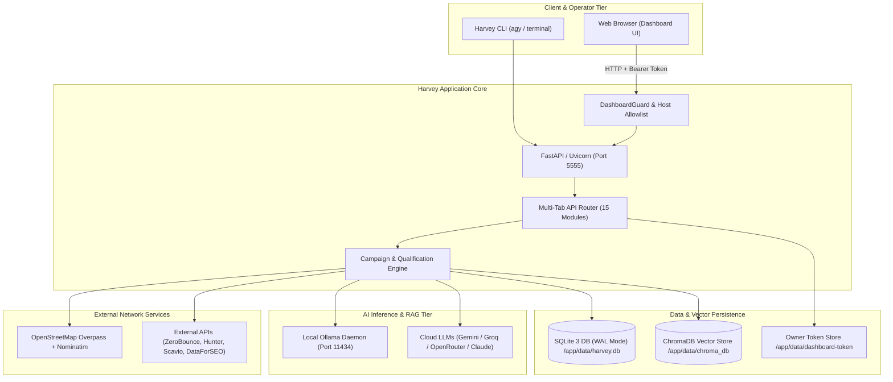

# Harvey AI Sales Agent — Production Deployment Guide

**Document Version:** 2.0.0  
**Target Environment:** Local, Docker, Render, Railway, AWS ECS, Fly.io  
**Last Verified Commit:** `e5f6af1`  

---

## 1. Architecture Overview

Harvey AI Sales Agent is built with a resilient, modular architecture designed for local privacy-first execution with full multi-cloud deployment capabilities.



---

## 2. Environment Variables Reference

Copy `.env.example` to `.env` and configure appropriate variables for your deployment target:

| Variable | Default | Purpose | Production Recommendation |
| :--- | :--- | :--- | :--- |
| `PORT` | `5555` | Server port | Set by hosting provider (e.g. Render `$PORT`) |
| `HARVEY_ALLOW_REMOTE_BIND` | `0` | Allows binding to `0.0.0.0` | Set to `1` in Docker and Cloud deployments |
| `HARVEY_ALLOWED_HOSTS` | `localhost,127.0.0.1` | Allowed Host header domains | Set to your domain (e.g. `*.onrender.com,sales.myco.com`) |
| `BRAIN_PROVIDER` | `ollama` | Active AI inference engine | `ollama` (local/VM) or `gemini`/`groq` (serverless cloud) |
| `OLLAMA_BASE_URL` | `http://127.0.0.1:11434` | Ollama API endpoint | `http://host.docker.internal:11434` or remote Ollama URL |
| `GEMINI_API_KEY` | *(empty)* | Google Gemini API key | Recommended for cloud containers without GPU |
| `GROQ_API_KEY` | *(empty)* | Groq ultra-fast LPU key | Optional high-speed cloud LLM |
| `DATABASE_PATH` | `data/harvey.db` | SQLite database file location | Keep inside persistent mount (`/app/data/harvey.db`) |
| `REQUIRE_APPROVAL` | `true` | Human-in-the-loop approval gate | **MUST be `true`** for outbound safety |
| `LIVE_SENDING_ENABLED` | `false` | Global email dispatch switch | **MUST be `false`** in pilot / staging |

---

## 3. Deployment Methods

### Option A: Local Bare-Metal / Development
```powershell
# 1. Clone repository
git clone https://github.com/ethanplusai/harvey.git
cd harvey

# 2. Create virtual environment & install dependencies
python -m venv .venv
.venv\Scripts\Activate.ps1
pip install -r requirements.txt
playwright install --with-deps chromium

# 3. Start Ollama inference daemon
ollama serve
ollama pull qwen2.5:1.5b
ollama pull nomic-embed-text

# 4. Start Harvey Web Command Deck
python -m harvey dashboard --port 5555
```

---

### Option B: Docker & Docker Compose (Standalone)

```bash
# 1. Prepare configuration
cp .env.example .env

# 2. Build and launch Harvey container
docker compose -f docker-compose.prod.yml up -d --build

# 3. View container logs
docker compose -f docker-compose.prod.yml logs -f harvey

# 4. Access dashboard
# Navigate to http://localhost:5555 in your browser
```

---

### Option C: Docker Compose with Companion Ollama Service

For dedicated Linux VM servers with local LLM acceleration:

```bash
# Launch both Harvey and an isolated Ollama container with persistent model volume
docker compose -f docker-compose.prod.yml --profile with-ollama up -d --build

# Download required models into the companion Ollama container
docker exec -it harvey-ollama ollama pull qwen2.5:1.5b
docker exec -it harvey-ollama ollama pull nomic-embed-text
```

---

### Option D: Render Cloud Deployment (1-Click Blueprint)

Harvey includes a verified `render.yaml` blueprint:

1. **Prerequisites:**
   - A GitHub repository with the latest code.
   - A Render account ([render.com](https://render.com)).
   - A Gemini API key (recommended for cloud container execution).

2. **Setup Steps:**
   - Log into Render Dashboard $\rightarrow$ **Blueprints** $\rightarrow$ **New Blueprint Instance**.
   - Connect the repository and branch `main`.
   - Render automatically detects `render.yaml`.
   - Set Secret Environment Variable `GEMINI_API_KEY` (or configure external `OLLAMA_BASE_URL`).
   - Click **Apply**.

3. **Persistent Disk:**
   - The blueprint mounts a 10 GB persistent disk at `/app/data` to ensure SQLite database records, ChromaDB vectors, and tokens survive container reboots.

---

### Option E: Railway / Fly.io / AWS ECS

For generic cloud container hosts:
1. Ensure `/app/data` is mounted to a persistent block volume.
2. Set environment variables:
   ```env
   HARVEY_ALLOW_REMOTE_BIND=1
   HARVEY_ALLOWED_HOSTS=*.up.railway.app,*.fly.dev,your-custom-domain.com
   BRAIN_PROVIDER=gemini # or groq / remote ollama
   REQUIRE_APPROVAL=true
   LIVE_SENDING_ENABLED=false
   ```
3. Expose port `5555` to the platform router.

---

## 4. Security Hardening & Production Checklist

- [x] **Host Header Protection:** Refuses DNS rebinding attacks; accepts only loopback or explicitly declared `HARVEY_ALLOWED_HOSTS`.
- [x] **Origin & CSRF Defense:** Enforces same-origin or explicit scheme (`http://` or `https://`) matching the host header.
- [x] **Bearer Token Gate:** All data and mutation endpoints strictly require a 32-byte cryptographic token.
- [x] **Safety Hold Active:** `sending_paused = "Pilot Evaluation - Read-Only Safety Hold"` prevents unapproved email dispatch.
- [x] **Read-Only Scopes:** Gmail connector restricted to `gmail.readonly`.
- [x] **Zero Live Secrets in Source:** `.env.example` contains only empty placeholders.

---

## 5. Health Checks & Verification

After deployment, verify the service with:

```bash
# Check basic daemon status
curl -H "Authorization: Bearer <DASHBOARD_TOKEN>" https://<YOUR_DEPLOYED_URL>/api/harvey/status

# Verify SQLite database and schema version
curl -H "Authorization: Bearer <DASHBOARD_TOKEN>" https://<YOUR_DEPLOYED_URL>/api/db/verify
```
