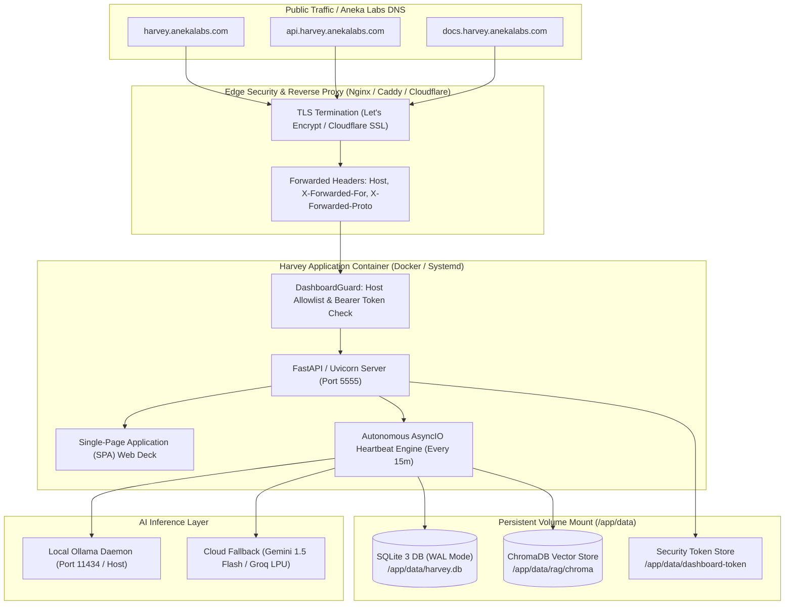

# Harvey AI Sales Agent — Production Deployment Guide

**Document Version:** 3.0.0
**Prepared for:** Jitesh Sir & Aneka Labs DevOps Team
**Domain Scope:** `anekalabs.com` (`harvey.anekalabs.com`, `api.harvey.anekalabs.com`, `docs.harvey.anekalabs.com`)
**Target Environments:** Linux VPS (Docker Compose / Systemd), Dedicated Cloud VMs, Render / Railway

---

## 1. Architecture Overview

Harvey AI Sales Agent is a unified, high-performance autonomous sales prospecting platform. It discovers leads via OpenStreetMap and multi-source APIs, enriches contacts, evaluates qualification against ICP criteria, generates personalized cold email drafts, and manages human-in-the-loop approval workflows.



---

## 2. Infrastructure Requirements & Sizing

| Component | Minimum Specification | Recommended Specification (Aneka Labs Prod) |
| :--- | :--- | :--- |
| **Operating System** | Ubuntu 22.04 LTS or Debian 12 (x86_64 or ARM64) | Ubuntu 24.04 LTS (x86_64 or ARM64) |
| **CPU** | 2 vCPU cores | 4 vCPU cores (e.g. Oracle A1 / Hetzner CPX21 / CX32) |
| **RAM** | 2.0 GB RAM | 4.0 GB – 8.0 GB RAM (Harvey peak usage: ~1.75 GB) |
| **Persistent Disk** | 20 GB SSD | 50 GB NVMe SSD mounted at `/app/data` |
| **Python Runtime** | Python 3.11.x or 3.12.x | Python 3.11.x in isolated venv or Docker container |
| **Reverse Proxy** | Nginx 1.20+ or Caddy 2.7+ | Nginx with certbot or Caddy automatic TLS |

---

## 3. Database Architecture & Persistence

Harvey utilizes **SQLite 3 with Write-Ahead Logging (WAL mode)** for low-latency, zero-configuration local ACID persistence.

### Why SQLite WAL over PostgreSQL/Redis for Harvey:
1. **Low Memory Footprint:** Eliminates separate database daemon processes, conserving ~400 MB of RAM on the host.
2. **Zero Network Latency:** In-process disk I/O eliminates loopback TCP overhead for fast analytical queries across campaigns, prospects, and outbox records.
3. **High Concurrency:** WAL mode allows concurrent readers while a single writer operates without table locking contention.
4. **Self-Contained Backups:** Zero-downtime hot backups can be taken at any instant with standard SQLite `VACUUM INTO` or `.backup` commands.

### Storage Persistence Guarantee:
All stateful data resides strictly inside the `data/` directory:
- `data/harvey.db` — SQLite database (prospects, companies, outbox, campaigns, audit logs).
- `data/rag/chroma/` — ChromaDB persistent vector collection (embedded company knowledge and PDFs).
- `data/dashboard-token` — High-entropy token securing the dashboard and REST APIs.

> [!IMPORTANT]
> When deploying via Docker, **always mount a persistent volume to `/app/data`**. Without this mount, container recreation will wipe all prospect records and vector embeddings.

---

## 4. Background Workers & Concurrency Model

Harvey's autonomous agent runs on a high-throughput, native **AsyncIO event loop** (`asyncio.sleep`, `aiosqlite`, `httpx.AsyncClient`).

### Clarification on Redis and Celery:
Harvey does **NOT** require an external Redis broker or Celery worker daemon.
- The background cycle (`harvey run` / `harvey.main.run_cycle`) runs as an internal scheduled task or managed supervisor process.
- The supervisor sleeps between evaluation cycles (default: 15 minutes) and processes discovery, scraping, ICP qualification, and outbox drafting.
- Running natively in AsyncIO avoids distributed worker race conditions, eliminates Celery configuration complexity, and ensures strict human-in-the-loop review invariants.

---

## 5. Deployment Options

### Method A: Docker Compose (Recommended Production Setup)

The repository provides a production-grade `docker-compose.prod.yml`.

#### Step 1: Clone Repository & Create Environment File
```bash
git clone https://github.com/anuradha-aneklabs/AI_code.git /opt/harvey
cd /opt/harvey
cp .env.example .env
```

#### Step 2: Configure Environment Variables
Edit `/opt/harvey/.env`:
```ini
HARVEY_ALLOW_REMOTE_BIND=1
HARVEY_ALLOWED_HOSTS=harvey.anekalabs.com,api.harvey.anekalabs.com,docs.harvey.anekalabs.com,localhost,127.0.0.1
GEMINI_API_KEY=your_gemini_api_key_here
NOMINATIM_CONTACT_EMAIL=devops@anekalabs.com
HARVEY_OPERATOR_EMAIL=jitesh@anekalabs.com
REQUIRE_APPROVAL=true
LIVE_SENDING_ENABLED=false
```

#### Step 3: Launch Containers
```bash
# Launch Harvey container with volume persistence
docker compose -f docker-compose.prod.yml up -d --build

# Inspect running container
docker compose -f docker-compose.prod.yml ps

# Inspect live application logs
docker compose -f docker-compose.prod.yml logs -f harvey
```

#### Step 4: Companion Ollama Inference (Optional Local LLM)
If running on a dedicated Linux VPS with Ollama support:
```bash
docker compose -f docker-compose.prod.yml --profile with-ollama up -d
docker exec -it harvey-ollama ollama pull qwen2.5:1.5b
docker exec -it harvey-ollama ollama pull nomic-embed-text
```

---

### Method B: Native Linux Systemd Service (Bare-Metal / VPS)

If hosting directly on an Ubuntu/Debian VPS without Docker:

#### Step 1: Install System Dependencies
```bash
sudo apt-get update && sudo apt-get install -y \
    python3.11 python3.11-venv python3.11-dev build-essential \
    curl git nginx certbot python3-certbot-nginx
```

#### Step 2: Setup User & Environment
```bash
sudo useradd -m -s /bin/bash harvey
sudo mkdir -p /opt/harvey
sudo chown -R harvey:harvey /opt/harvey

# Switch to harvey user
sudo -u harvey -i
git clone https://github.com/anuradha-aneklabs/AI_code.git /opt/harvey
cd /opt/harvey

# Create virtual environment
python3.11 -m venv .venv
source .venv/bin/activate
pip install --upgrade pip
pip install -r requirements.txt
playwright install --with-deps chromium

cp .env.example .env
# Edit .env with production parameters
exit
```

#### Step 3: Install Systemd Service
Copy the provided unit template `harvey.service` to systemd:
```bash
sudo cp /opt/harvey/harvey.service /etc/systemd/system/harvey.service
sudo systemctl daemon-reload
sudo systemctl enable harvey
sudo systemctl start harvey
sudo systemctl status harvey
```

---

## 6. Reverse Proxy & Domain Configuration (Aneka Labs)

To expose Harvey under the Aneka Labs domain hierarchy (`*.anekalabs.com`), place Nginx in front of Harvey's local port (`5555`).

### Nginx Configuration File (`/etc/nginx/sites-available/harvey.anekalabs.com`)

```nginx
# =========================================================================
# Harvey AI Sales Agent — Aneka Labs Reverse Proxy
# =========================================================================

# 1. Main Application & Dashboard UI
server {
    server_name harvey.anekalabs.com;

    location / {
        proxy_pass http://127.0.0.1:5555;
        proxy_http_version 1.1;

        # Mandatory Forwarded Headers for Harvey Host Header Defense
        proxy_set_header Host $host;
        proxy_set_header X-Real-IP $remote_addr;
        proxy_set_header X-Forwarded-For $proxy_add_x_forwarded_for;
        proxy_set_header X-Forwarded-Proto $scheme;

        # WebSocket & Streaming Response Support
        proxy_set_header Upgrade $http_upgrade;
        proxy_set_header Connection "upgrade";
        proxy_read_timeout 300s;
        proxy_connect_timeout 60s;
        proxy_send_timeout 300s;

        # Buffer limits
        client_max_body_size 25M;
    }

    listen 80;
}

# 2. Dedicated API Gateway Subdomain
server {
    server_name api.harvey.anekalabs.com;

    location / {
        proxy_pass http://127.0.0.1:5555;
        proxy_http_version 1.1;

        proxy_set_header Host $host;
        proxy_set_header X-Real-IP $remote_addr;
        proxy_set_header X-Forwarded-For $proxy_add_x_forwarded_for;
        proxy_set_header X-Forwarded-Proto $scheme;

        proxy_read_timeout 300s;
        client_max_body_size 25M;
    }

    listen 80;
}

# 3. Interactive API Documentation
server {
    server_name docs.harvey.anekalabs.com;

    location / {
        # Rewrites root to FastAPI OpenAPI Swagger documentation
        proxy_pass http://127.0.0.1:5555/docs;
        proxy_http_version 1.1;

        proxy_set_header Host $host;
        proxy_set_header X-Real-IP $remote_addr;
        proxy_set_header X-Forwarded-For $proxy_add_x_forwarded_for;
        proxy_set_header X-Forwarded-Proto $scheme;
    }

    listen 80;
}
```

### Enable Site and Install SSL Certificates
```bash
sudo ln -s /etc/nginx/sites-available/harvey.anekalabs.com /etc/nginx/sites-enabled/
sudo nginx -t
sudo systemctl reload nginx

# Issue Let's Encrypt SSL Certificates for all subdomains
sudo certbot --nginx -d harvey.anekalabs.com -d api.harvey.anekalabs.com -d docs.harvey.anekalabs.com
```

---

## 7. Health Checks & Verification

Perform these automated verification checks immediately after deployment:

### 1. Health Status Endpoint
```bash
# Obtain dashboard token from container
TOKEN=$(docker exec harvey-sales-agent cat /app/data/dashboard-token 2>/dev/null || cat /opt/harvey/data/dashboard-token)

# Query Harvey Engine Status
curl -fsSL -H "Authorization: Bearer $TOKEN" https://harvey.anekalabs.com/api/harvey/status
```
*Expected response:* `{"running": true, "pid": ..., "mode": ...}`

### 2. Database Integrity Endpoint
```bash
curl -fsSL -H "Authorization: Bearer $TOKEN" https://harvey.anekalabs.com/api/db/verify
```
*Expected response:* `{"ok": true, "quick_check": ["ok"], "user_version": 24, "wal_checkpoint": [0,0,0]}`

### 3. RAG Knowledge Collection Verification
```bash
curl -fsSL -H "Authorization: Bearer $TOKEN" https://harvey.anekalabs.com/api/rag/status
```
*Expected response:* `{"ok": true, "chunks_count": 40, "status": "healthy"}`

---

## 8. Backup & Disaster Recovery Runbook

### Automated Daily Hot Backup Script
Create `/opt/harvey/scripts/backup_harvey.sh`:

```bash
#!/bin/bash
set -euo pipefail

BACKUP_DIR="/opt/harvey/backups/$(date +%Y-%m-%d_%H%M%S)"
mkdir -p "$BACKUP_DIR"

echo "Starting hot backup of Harvey data..."

# 1. Zero-downtime SQLite hot backup via VACUUM INTO
sqlite3 /opt/harvey/data/harvey.db "VACUUM INTO '$BACKUP_DIR/harvey.db';"

# 2. Archive ChromaDB vector data
tar -czf "$BACKUP_DIR/rag_chroma.tar.gz" -C /opt/harvey/data/rag chroma

# 3. Securely archive dashboard auth tokens
cp /opt/harvey/data/dashboard-token "$BACKUP_DIR/" 2>/dev/null || true

# 4. Retain last 14 days of backups
find /opt/harvey/backups -mindepth 1 -maxdepth 1 -type d -mtime +14 -exec rm -rf {} +

echo "Backup complete: $BACKUP_DIR"
```

Add to cron (`crontab -e`):
```cron
0 2 * * * /opt/harvey/scripts/backup_harvey.sh >> /var/log/harvey_backup.log 2>&1
```

### Full Disaster Recovery Restore Procedure
1. Stop the Harvey service: `sudo systemctl stop harvey` (or `docker compose down`).
2. Restore database: `cp /opt/harvey/backups/<TARGET_BACKUP>/harvey.db /opt/harvey/data/harvey.db`.
3. Restore ChromaDB: `tar -xzf /opt/harvey/backups/<TARGET_BACKUP>/rag_chroma.tar.gz -C /opt/harvey/data/rag/`.
4. Restore permissions: `sudo chown -R harvey:harvey /opt/harvey/data`.
5. Restart service: `sudo systemctl start harvey` (or `docker compose up -d`).
6. Run `python scripts/verify_post_cleanup.py` to confirm state integrity.

---

## 9. Troubleshooting Runbook

| Symptom | Probable Cause | Action |
| :--- | :--- | :--- |
| **HTTP 400 `bad_host`** | Reverse proxy is sending an unlisted `Host` header | Ensure `harvey.anekalabs.com` is included in `HARVEY_ALLOWED_HOSTS` in `.env`. Check that Nginx sets `proxy_set_header Host $host;`. |
| **HTTP 401 Unauthorized** | Missing or incorrect Bearer token in request header | Read token from `/app/data/dashboard-token` or `.dashboard-token` and pass `Authorization: Bearer <token>`. |
| **Status shows "Harvey is stopped"** | Background engine not started | Verify `HARVEY_AUTOSTART_ENGINE=1` in `.env` or click "Start Harvey" in the Controls tab. Inspect logs for LLM connection errors. |
| **Playwright Chromium Launch Error** | Missing Linux GUI shared libraries | In Docker, ensure base image includes Playwright deps. On VPS, run `playwright install --with-deps chromium`. |
| **SQLite `database is locked`** | Concurrent multi-process write without WAL | Run `python -c "import sqlite3; c=sqlite3.connect('data/harvey.db'); c.execute('PRAGMA journal_mode=WAL;');"` to ensure WAL mode. |
| **Nominatim Email Warning** | Missing contact email for OpenStreetMap queries | Set `NOMINATIM_CONTACT_EMAIL=devops@anekalabs.com` in `.env`. |
