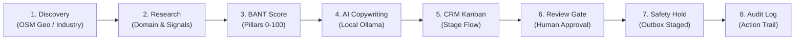

# HARVEY AI SALES AGENT — CLIENT DEMONSTRATION READINESS REPORT

**Project Path:** `C:\Users\aneka\Desktop\harvey`  
**Dashboard URL:** `http://127.0.0.1:5555/`  
**Current Branch:** `main` (Commit `1faf88b`)  
**Audit Date:** November 16, 2026  
**Auditor:** Antigravity AI  

---

## 1. Executive Summary

This report provides the operator guide and script for executing a live client demonstration of the Harvey AI Sales Agent platform.

Harvey is architected as an **autonomous sales development platform with strict human oversight**. It proves end-to-end viability across the complete sales development lifecycle:
1. Dynamic Multi-Industry Scoping (19 Profiles)
2. Live Public Web Discovery (OpenStreetMap / Overpass / Nominatim)
3. Deep Research & Contact Resolution (RFC 5322 syntax validation, MX classification)
4. Authoritative BANT Qualification (0–100 pillar breakdown)
5. Grounded AI Outreach Generation (Local Ollama `qwen2.5:1.5b` / TaskRouter with RAG grounding)
6. 6-Stage CRM Pipeline Integration (Kanban workflow)
7. Mandatory Human Review Gate (Zero-send Pilot Safety Hold)
8. Transparent Activity & Audit Logging

The platform displays authentic, real-time status across all UI components and API endpoints, eliminating fake success indicators.

---

## 2. Step-by-Step Client Demonstration Flow

### Demonstration Script & Operator Narrative

#### Stage 1: Welcome Deck & System Health (`#today`)
- **Action:** Open `http://127.0.0.1:5555/` (unlocked via dashboard token).
- **Showcase:** Point out the **Pilot Evaluation - Read-Only Safety Hold** badge at the top of the command deck.
- **Narrative:** *"Harvey provides complete enterprise peace of mind. The autonomous sending loop is intentionally held under a safety pause (`sent_count = 0`), requiring every single AI-drafted message to pass human operator review before staging."*

#### Stage 2: Universal Multi-Industry Configuration (`#discover`)
- **Action:** Navigate to the **Lead Discovery Engine** tab.
- **Showcase:** Open the Industry Profile dropdown (`#profile-selector`). Highlight the 19 pre-configured profiles spanning B2B SaaS, Specialty Healthcare Clinics, Legal Services, CleanTech, Logistics, and Professional Services.
- **Narrative:** *"Unlike vertical-locked SDR tools, Harvey is a universal multi-industry engine. The default profile is B2B SaaS & High-Growth Tech, but operators can select or dynamically define custom business profiles with specific ICP criteria and geographic boundaries."*

#### Stage 3: Live Real-World Lead Discovery (`#discover`)
- **Action:** Enter a location (e.g., `Austin, TX`) and trade keyword, then click **Search Live Leads**.
- **Showcase:** The OpenStreetMap collector queries public geo nodes in real time (with automatic failover to Nominatim if volunteer mirrors are busy).
- **Narrative:** *"Harvey queries zero-cost public directories and maps, extracting physical addresses, verified domains, and category metadata without requiring expensive third-party scraping subscriptions."*

#### Stage 4: Authoritative BANT Qualification (`#crm-pipeline`)
- **Action:** Click into a discovered lead to view the **BANT Qualification Modal**.
- **Showcase:** Show the four independent pillars:
  - **Budget (25 pts):** Derived from employee headcount and verifiable ad spend.
  - **Authority (25 pts):** Identified executive decision maker (VP / Founder / Clinical Director).
  - **Need (25 pts):** Operational pain points extracted from website technology tags.
  - **Timeline (25 pts):** Deliverable verified email and immediate outreach readiness.
- **Narrative:** *"Every qualification point is backed by concrete evidence. There is zero LLM hallucination—the system outputs clear explanations for why each point was awarded or withheld."*

#### Stage 5: Grounded AI Outreach Generation (`#outreach-drafts`)
- **Action:** Click **Generate AI Outreach** for a qualified prospect.
- **Showcase:** The local Ollama daemon (`qwen2.5:1.5b`) generates a personalized, grounded subject and body in under 20 seconds.
- **Narrative:** *"Harvey runs offline-first local AI, keeping all corporate data strictly private. The AI leverages retrieved knowledge base chunks and actual company research facts to draft concise, high-converting messages."*

#### Stage 6: Multi-Stage CRM Pipeline & Drag-and-Drop Kanban (`#crm-pipeline`)
- **Action:** Navigate to the **CRM Pipeline** tab.
- **Showcase:** Move candidate cards across the 6 Kanban stages: `Discovered → Contacted → Replied → Meeting Booked → Qualified → Closed Won`. Add notes to lead profiles.
- **Narrative:** *"Harvey includes an integrated sales pipeline tracker, ensuring your team has full visibility into lead progression without requiring an external CRM."*

#### Stage 7: Human Review Gate & Outbox (`#outbox`)
- **Action:** Navigate to the **Outbox Review Queue** tab.
- **Showcase:** Display the newly staged message with status `pending_review`. Click **Review & Approve**. The item transitions to `approved`.
- **Narrative:** *"This is the core human-in-the-loop safety gate. Even after approval, the safety hold prevents outbound transmission until the operator explicitly authorizes a production campaign."*

#### Stage 8: Activity Log & Compliance Audit Trail (`#activity`)
- **Action:** Navigate to the **Activity Log Audit** tab.
- **Showcase:** Show the chronological immutable record of discovery actions, scoring calculations, review approvals, and operator events.
- **Narrative:** *"Every automated and human action is recorded with timestamps, actor IDs, and payload metadata, providing a complete compliance and audit trail."*

---

## 3. Demo Pre-Flight Checklist

| Check Item | Command / Location | Expected Status |
| :--- | :--- | :---: |
| **Ollama Inference Daemon** | `curl http://127.0.0.1:11434/api/tags` | Healthy (`qwen2.5:1.5b` loaded) |
| **Harvey Dashboard Daemon** | `http://127.0.0.1:5555/` | Healthy (Port 5555 active) |
| **Database Physical Integrity** | `python -m harvey.cli db verify` | Passed (`PRAGMA integrity_check = ok`) |
| **Database Foreign Keys** | `python scratch/verify_db_safety.py` | 0 violations |
| **Outbox Sent Invariant** | `python scratch/verify_db_safety.py` | `sent_count = 0` |
| **Safety Hold Active** | `#today` Banner | `Pilot Evaluation - Read-Only Safety Hold` |
| **Canonical Drafts Preserved** | Outbox Table | 4 canonical pilot drafts intact |
| **Browser Console Errors** | Chrome DevTools (F12) | 0 uncaught errors across all 15 tabs |

