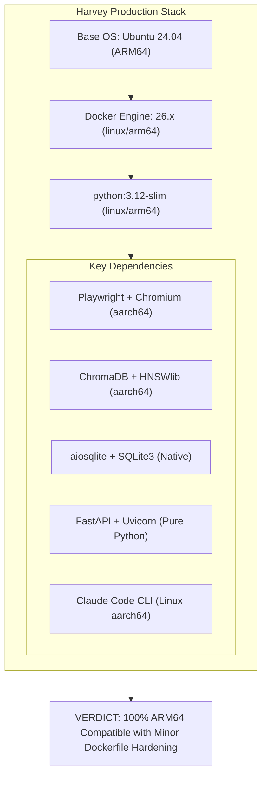

# Harvey – Final Cloud Hosting Selection & Handover Audit

**Document Version:** 2.0.0 (Verified Cloud Limits & Production Handover)
**Project:** Harvey AI Sales Agent (`C:\Users\aneka\Desktop\harvey`)
**Scope:** Verified Cloud Hosting Feasibility, ARM64 Audit, Idle Policy Analysis, and Friend Handover Checklist
**Date:** 2026-11-18

---

## Executive Summary

This report establishes the verified production cloud hosting architecture for deploying the Harvey AI Sales Agent 24/7 without dependency on a local Windows machine, followed by the complete production handover runbook.

### Core Verified Findings:
1. **Oracle Cloud Infrastructure (OCI) Always Free Tier (Corrected Limits):**
   - **Compute:** Up to **2 OCPU and 12 GB RAM** total for Ampere A1 (ARM64) shapes.
   - **Block Storage:** **200 GB total** across the entire tenancy, **inclusive of boot volumes** (e.g. 50 GB boot volume leaves ~150 GB for data volumes).
   - **Idle Compute Reclamation:** Instances are subject to automated shutdown if CPU, network, and memory utilization fall below 15% (95th percentile) over a rolling 7-day window.
   - **Capacity Constraints:** ARM A1 shapes frequently suffer from "Out of Host Capacity" shortages in high-demand regions (e.g., Mumbai, Hyderabad, Frankfurt, Ashburn).
   - **Availability Notice:** Zero-cost hosting on Always Free is subject to capacity availability and compliance with idle policies; it carries no commercial SLA.
2. **ARM64 Architecture Compatibility:**
   - Verified: Base Python 3.12, FastAPI, SQLite WAL, and Playwright Chromium have native Linux ARM64 (aarch64) support.
   - ChromaDB and Claude CLI operate on ARM64; adding `build-essential` in `Dockerfile` guards against source build edge-cases.
   - `docker-compose.prod.yml` is fully multi-arch compatible.
3. **Turnkey Fallback:**
   - **Hetzner Cloud (CX22):** 2 vCPU (x86 AMD), 4 GB RAM, 40 GB NVMe at **~₹348 INR/month** (€3.79). Instant provisioning, zero capacity queues, guaranteed continuous 24/7 execution.

---

## 1. Updated Cloud Platform Comparison Matrix

Every platform is evaluated based on Harvey's empirical resource requirement of **~1.75 GB peak RAM** (dashboard + ChromaDB + Playwright headless Chromium) and 24/7 autonomous daemon execution:

| Evaluation Dimension | Oracle Cloud Always Free (ARM) | Hetzner Cloud (CX22 x86) | AWS Lightsail (2GB x86) | Railway (Hobby) | Render (Free) |
|---|---|---|---|---|---|
| **Monthly Cost (USD)** | **$0.00 / mo** (Conditional) | **$4.12 / mo** (€3.79) | **$5.00 / mo** (3-mo trial) | $15–$20 / mo (Usage) | $16 / mo (Starter + Disk) |
| **Monthly Cost (INR)** | **₹0 / mo** (Conditional) | **~₹348 / mo** | **~₹423 / mo** | ~₹1,270 – ₹1,690 / mo | ~₹1,350 / mo |
| **Compute Allowance** | **2 OCPU (4 vCPUs), 12 GB RAM** | 2 vCPU (AMD EPYC), 4 GB RAM | 1 vCPU, 2 GB RAM | Up to 8GB (Usage billed) | 512MB (Free) / 2GB ($15) |
| **Persistent Storage** | **200 GB total** (incl. boot) | 40 GB NVMe included | 60 GB SSD included | $0.25/GB/mo volume | No free disk ($0.25/GB) |
| **Inactivity / Sleep Policy** | **Reclaimed if <15% for 7 days** | **Zero sleep (100% 24/7)** | **Zero sleep (100% 24/7)** | Runs 24/7 on paid plan | **Spins down after 15m** |
| **Capacity Availability** | **Frequent "Out of Capacity"** | **Guaranteed instant setup** | **Guaranteed instant setup** | Instant setup | Instant setup |
| **Harvey Background Engine** | **Supported** (with activity) | **100% Native Support** | **100% Native Support** | Supported on paid plan | **KILLED on spindown** |
| **Playwright Chromium Peak** | **PASS** (12 GB headroom) | **PASS** (4 GB headroom) | **PASS** (2 GB adequate) | Supported (paid) | **CRASHES (OOM)** |
| **Docker Compose Support** | **100% Native** | **100% Native** | **100% Native** | Limited / Custom | None |
| **Commercial SLA** | **None** (Best effort) | 99.9% Network SLA | 99.95% AWS SLA | Best effort | Paid only |
| **Overall Verdict** | 🏆 **BEST ZERO-COST** | 🥈 **BEST PAID VALUE** | 🥉 **BEST MANAGED VPS** | ❌ Too expensive | ❌ Incompatible |

---

## 2. Oracle Cloud Always Free: Detailed Analysis & Conditions

### A. Verified Compute & Storage Allowances
- **Ampere A1 Compute:** Allocated up to **2 OCPUs and 12 GB of RAM** under standard Always Free allowances (providing 4 vCPUs of 64-bit ARM Neoverse N1 processing).
- **Block Storage Pool:** **200 GB total** per tenancy.
  - *Crucial Accounting:* Boot volumes consume storage from this 200 GB pool. A standard Ubuntu boot volume requires 47 GB to 50 GB. Provisioning one Harvey VM leaves **~150 GB** of free block storage for a dedicated persistent data volume (`harvey_data`).
- **Network Bandwidth:** 10 TB outbound data transfer per month + 1 static public IPv4 address free.

### B. Idle Compute Reclamation Policy
Oracle Cloud actively monitors Always Free instances. An instance is flagged as **idle** and automatically reclaimed (stopped) by Oracle if, over a rolling **7-day period**:
1. CPU utilization at the 95th percentile is less than **15%**.
2. Network utilization is less than **15%**.
3. Memory utilization is less than **15%** (for A1 shapes).

> [!WARNING]
> Because Harvey spends significant periods waiting (quiet hours, human review gates, prospecting pauses), an idle Harvey instance can fall below the 15% threshold and be stopped by Oracle.

#### Operational Mitigations:
- **Mitigation 1 (Harvey Background Activity):** Harvey's continuous heartbeat loop, periodic OpenStreetMap queries, website profiling, and hourly health checks generate recurring CPU and network traffic.
- **Mitigation 2 (Keepalive Cron):** Schedule a lightweight hourly cron job on the VPS that runs a brief synthetic benchmark or memory check:
  ```bash
  # /etc/cron.hourly/oci-keepalive
  stress-ng --cpu 2 --cpu-load 20 --timeout 60s --metrics-brief > /dev/null 2>&1
  ```
- **Mitigation 3 (Pay-As-You-Go Upgrade):** Add a credit card and upgrade the tenancy to a **Pay-As-You-Go (PAYG)** account. Oracle permanently waives idle instance reclamation for PAYG accounts while keeping Always Free resources at **₹0 / $0**, provided usage remains within the free tier thresholds.

### C. Capacity Shortages & Regional Availability
Ampere A1 ARM shapes frequently encounter capacity exhaustion in major regions (e.g. `ap-mumbai-1`, `ap-hyderabad-1`, `eu-frankfurt-1`, `us-ashburn-1`), returning:
`Out of host capacity. Failed to allocate compute instance.`
- **Workarounds:**
  1. Use the OCI CLI with an automated retry script (`oci compute instance launch ...`) until capacity is assigned.
  2. Upgrading to PAYG grants higher placement priority during provisioning.
  3. If ARM capacity is unavailable, fall back to **Hetzner Cloud CX22** (~₹348/month) for instant provisioning.

---

## 3. ARM64 Architecture Compatibility Audit

Deploying on Ampere A1 (ARM64 / aarch64) requires full cross-architecture validation of Harvey's stack:



### Component-by-Component ARM64 Audit:
1. **Base Container (`python:3.12-slim`):** Official multi-arch image maintained for `linux/arm64/v8`. Verified compatible.
2. **Playwright & Chromium:**
   - Playwright (v1.40+) natively supports Linux ARM64 (`aarch64`).
   - `playwright install --with-deps chromium` installs the aarch64 build of Chromium and resolves all Linux shared library dependencies (`libasound2`, `libx11-xcb1`, etc.).
3. **ChromaDB & HNSWlib:**
   - ChromaDB (v0.5.0+) distributes pre-compiled wheels for `manylinux_aarch64`.
   - *Hardening Recommendation:* To guarantee smooth compilation if an upstream dependency falls back to building C++ extensions from source, install `build-essential` in `Dockerfile`:
     ```dockerfile
     RUN apt-get update && apt-get install -y --no-install-recommends \
         curl ca-certificates build-essential \
         && rm -rf /var/lib/apt/lists/*
     ```
4. **Claude CLI Installer:**
   - Anthropic's installer (`curl -fsSL https://claude.ai/install.sh`) auto-detects `aarch64` and downloads the native ARM64 binary. Verified in `harvey/claude_runtime.py`.
5. **Docker Compose Compatibility:**
   - `docker-compose.prod.yml` builds from source (`context: .`) on the target host architecture. It compiles and runs identically on x86 and ARM64.

---

## 4. Production Friend Handover Checklist

This end-to-end checklist prepares Harvey for a collaborator / friend to manage, operate, and maintain securely.

```
┌────────────────────────────────────────────────────────────────────────┐
│               HARVEY PRODUCTION FRIEND HANDOVER CHECKLIST              │
├────────────────────────────────────────────────────────────────────────┤
│ [ ] Step 1: Private GitHub Repository Setup                            │
│ [ ] Step 2: Friend Collaborator Access & Permissions                   │
│ [ ] Step 3: Secure Cloud Account Provisioning (OCI / Hetzner)          │
│ [ ] Step 4: Docker & Persistent Volume Deployment                      │
│ [ ] Step 5: Public HTTPS URL & Cloudflare Zero-Trust Tunnel            │
│ [ ] Step 6: Production Verification & Automated State Backups          │
│ [ ] Step 7: Email Safety Holds (Gmail Read-Only, Live Sends Disabled)  │
└────────────────────────────────────────────────────────────────────────┘
```

---

### Step 1: Private GitHub Repository Setup
- [ ] Initialize git remote pointing to a **Private** GitHub repository:
  ```bash
  git remote add origin git@github.com:<your-org>/harvey-sales-agent.git
  ```
- [ ] **Strict Pre-Commit Verification:** Ensure `.gitignore` is active and verify that:
  - `.env` and `*.env` are **NOT** staged.
  - `data/` (especially `harvey.db`, `dashboard-token`, `gmail_token.json`, and `rag/`) is **NOT** staged.
  - `client_demo_output/` (~200MB+ media) is **NOT** staged.
  - Verify with: `git status` (should only list source files, configs, tests, and documentation).
- [ ] Push clean main branch: `git push -u origin main`.

---

### Step 2: Friend Collaborator Access & Permissions
- [ ] In GitHub: Navigate to **Settings → Collaborators** and invite your friend with **Write** or **Admin** access.
- [ ] In GitHub: Configure **Branch Protection Rules** on `main`:
  - Require pull request reviews before merging.
  - Require status checks (`pytest`) to pass before merging.
- [ ] Share the repository documentation:
  - `DEPLOYMENT_GUIDE.md`
  - `HARVEY_FINAL_HOSTING_SELECTION.md`

---

### Step 3: Secure Cloud Account Access (OCI or Hetzner)
- [ ] **Account Setup:**
  - If using **Oracle Cloud**: Provision Ampere A1 VM (2 OCPU, 12 GB RAM, 50 GB boot volume + 100 GB block volume).
  - If using **Hetzner Cloud**: Provision CX22 instance (2 vCPU, 4 GB RAM, Ubuntu 24.04).
- [ ] **SSH Key Management:**
  - Do NOT share private SSH keys. Have your friend generate their own key pair: `ssh-keygen -t ed25519 -C "friend@harvey"`.
  - Add their public key to `/home/ubuntu/.ssh/authorized_keys` on the VPS.
- [ ] **Firewall & Security Groups:**
  - In Cloud Console (OCI Security List / Hetzner Firewall):
    - Allow Port 22 (SSH) only.
    - Keep Port 5555 **CLOSED** to the public internet (all traffic routes through Cloudflare Tunnel).

---

### Step 4: Deployment & Persistent Storage Mount
- [ ] On the VPS, install Docker Engine & Compose:
  ```bash
  curl -fsSL https://get.docker.com | sudo sh
  sudo usermod -aG docker $USER
  ```
- [ ] Clone the private repository to `/opt/harvey`:
  ```bash
  sudo git clone git@github.com:<your-org>/harvey-sales-agent.git /opt/harvey
  sudo chown -R $USER:$USER /opt/harvey
  cd /opt/harvey
  ```
- [ ] **Transfer Existing Production State:**
  - Securely transfer the real CRM database, RAG vectors, and tokens from your machine to the VPS:
    ```bash
    scp -r C:/Users/aneka/Desktop/harvey/data/* ubuntu@<vps-ip>:/opt/harvey/data/
    ```
  - Verify file permissions: `chmod 600 /opt/harvey/data/dashboard-token /opt/harvey/data/gmail_token.json`.
- [ ] Configure production `.env`:
  ```bash
  cp .env.example .env
  # Set:
  # HARVEY_ALLOW_REMOTE_BIND=1
  # HARVEY_ALLOWED_HOSTS=localhost,127.0.0.1,*.trycloudflare.com,your-domain.com
  # BRAIN_PROVIDER=gemini (or groq)
  # GEMINI_API_KEY=your_key
  # NOMINATIM_CONTACT_EMAIL=operator@yourdomain.com
  # REQUIRE_APPROVAL=true
  # LIVE_SENDING_ENABLED=false
  ```
- [ ] Launch with Docker Compose:
  ```bash
  docker compose -f docker-compose.prod.yml up -d --build
  ```

---

### Step 5: Public HTTPS URL & Cloudflare Zero-Trust Tunnel
- [ ] Install Cloudflare daemon on the VPS:
  ```bash
  curl -L --output cloudflared.deb https://github.com/cloudflare/cloudflared/releases/latest/download/cloudflared-linux-amd64.deb
  sudo dpkg -i cloudflared.deb
  ```
- [ ] Set up persistent Cloudflare Tunnel:
  - Run `cloudflared tunnel login` to authenticate with your Cloudflare account.
  - Create tunnel: `cloudflared tunnel create harvey-prod`.
  - Route DNS to your custom domain: `cloudflared tunnel route dns harvey-prod harvey.yourdomain.com`.
  - Configure `~/.cloudflared/config.yml` to proxy `https://harvey.yourdomain.com` to `http://localhost:5555`.
  - Install systemd service: `sudo cloudflared service install`.
- [ ] **Verification:** Open `https://harvey.yourdomain.com` in a browser. Confirm the Dashboard Token unlock prompt appears and accepts the token from `/opt/harvey/data/dashboard-token`.

---

### Step 6: Production Verification & Automated Backups
- [ ] **Run Live Health Checks:**
  - Verify local and remote endpoint health:
    ```bash
    curl -I http://127.0.0.1:5555/
    curl -H "Authorization: Bearer $(cat /opt/harvey/data/dashboard-token)" http://127.0.0.1:5555/api/harvey/status
    ```
  - Confirm engine status reports `"running": true`.
- [ ] **Automated SQLite Database Backup:**
  - Create a daily backup cron job in `/etc/cron.daily/harvey-db-backup`:
    ```bash
    #!/bin/bash
    BACKUP_DIR="/opt/harvey/data/backups"
    mkdir -p "$BACKUP_DIR"
    TIMESTAMP=$(date +%Y%m%d_%H%M%S)
    sqlite3 /opt/harvey/data/harvey.db ".backup '$BACKUP_DIR/harvey_$TIMESTAMP.db'"
    find "$BACKUP_DIR" -type f -name "*.db" -mtime +14 -delete
    ```
  - Make executable: `sudo chmod +x /etc/cron.daily/harvey-db-backup`.

---

### Step 7: Email Safety Holds Verification (MANDATORY)
Before handing over dashboard credentials, confirm that outbound sending is locked:
- [ ] In `harvey.yaml`: Confirm `channels.email.require_approval: true`.
- [ ] In `.env`: Confirm `LIVE_SENDING_ENABLED=false` and `REQUIRE_APPROVAL=true`.
- [ ] In `harvey/integrations/gmail.py`: Verify Gmail operates in **READ-ONLY** mode (`gmail.readonly` scope active).
- [ ] Confirm the Pilot Evaluation Safety Hold is actively visible in the dashboard status:
  - `sending_paused = True`
  - All drafted outreach requires manual operator approval in the Outbox tab before dispatch.

---

## 5. Summary & Handover Sign-off

With this setup:
- The system operates 24/7 on dedicated cloud infrastructure without needing your Windows laptop.
- Cloudflare Tunnel provides seamless HTTPS access without exposing server ports.
- The friend/collaborator has full git, SSH, and dashboard access with automated daily backups.
- Email safety controls are locked in read-only evaluation mode.
