# Harvey AI Sales Agent — Final Production Readiness Report

**Project Path:** `C:\Users\aneka\Desktop\harvey`  
**Current Git Commit:** `e1e8e8d69426f29a6ca9d1dab0cb6e713f95bcc6`  
**Report Date:** 2026-11-14  
**Operating System:** Windows 11 Enterprise (Python 3.11.9, `.venv\Scripts\python.exe`)  
**Production Readiness Verdict:** **CERTIFIED FOR CONTROLLED PRODUCTION PILOT DEPLOYMENT**  

---

## 1. Executive Summary

The Harvey AI Sales Agent platform has successfully concluded its complete development, stabilization, and live integration verification phases.

Every core module—including spatial lead discovery, public web enrichment, multi-profile ICP and BANT qualification, local vector RAG, local neural completion, human-in-the-loop outbox review, and the 15-tab operations dashboard—is fully functional, persistent across system restarts, and empirically verified against automated test suites.

### Key Metrics Summary
| Metric | Result | Status |
| :--- | :--- | :--- |
| **Full Pytest Suite** | **3,154 Passed, 184 Skipped, 0 Failed, 0 Errors** (533.12s) | **PASS (Exit 0)** |
| **Playwright UI Audit** | **15/15 Dashboard Tabs Audited** (0 console errors, 0 failed requests) | **PASS** |
| **Database Schema** | **v23** (`PRAGMA integrity_check = ok`, `foreign_key_check = []`) | **PASS (0 Errors)** |
| **Cold-Boot Persistence** | **15/15 State & API Parameters Exactly Matched** post-restart | **PASS** |
| **End-to-End Workflow** | **9/9 Functional Stages Verified** (Discovery to Outbox Review) | **PASS** |
| **AI Inference (Local)** | Ollama `qwen2.5:1.5b` (3.6s) & `nomic-embed-text` (48ms) operational | **PASS** |
| **Safety Invariants** | `sent_count = 0`, `require_approval = true`, `sending_paused` active | **CERTIFIED** |

---

## 2. Test Evidence & Regression Audit

### 2.1 Complete Pytest Execution
- **Command:** `.venv\Scripts\pytest.exe -q`
- **Output:** `3154 passed, 184 skipped in 533.12s (0:08:53)`
- **Exit Code:** `0`
- **Zero Regressions:** All unit, integration, qualification, and regression tests passed without assertion weakening.

### 2.2 Mathematical Accounting of the 184 Skipped Tests
Every single one of the 184 skipped tests has been categorized and mathematically accounted for:
1. **176 tests in `tests/test_codex*.py` (Codex CLI Unix Daemon):**
   - Reason: Requires POSIX process groups (`os.setpgrp`), POSIX signal handling (`signal.SIGSTOP`, `signal.SIGCONT`), and Unix filesystem permissions.
   - Code Condition: `pytestmark = pytest.mark.skipif(sys.platform == "win32", reason="Codex daemon requires POSIX")`.
   - On Windows, Harvey utilizes its native Windows process model and background daemon architecture.
2. **3 tests in `tests/test_claude_cli_isolation.py` (Claude CLI Subscription Session):**
   - Reason: Requires live interactive Claude CLI authentication (`HARVEY_CLAUDE_CLI_TESTS=1`).
3. **5 tests across Miscellaneous Modules (Platform Environment Specifics):**
   - `test_sending_mode.py` (2 tests): Non-elevated Windows filesystem symlink privilege constraints.
   - `test_brain_no_tools.py` (1 test): POSIX shell syntax assertion.
   - `test_pidfile.py` (1 test): Linux `/proc` filesystem process table inspection.
   - `test_packaging.py` (1 test): Debian/RPM Linux packaging toolchain requirement.
4. **Summary:** **Zero tests are skipped due to unhandled application crashes or broken business logic.**

---

## 3. UI & Playwright 15-Tab Browser Audit

The complete web dashboard at `http://127.0.0.1:5555/` was audited using Playwright headless browser automation (`scratch/audit_browser_tabs.py`):

| Tab Index | Tab ID | Screen Name | HTTP Status | Console Errors | Network Failures | Visual State |
| :---: | :--- | :--- | :---: | :---: | :---: | :--- |
| 1 | `today` | Today's Overview & Daily Pulse | 200 | 0 | 0 | Metrics rendered; charts active |
| 2 | `outbox` | Outreach Outbox & Review Queue | 200 | 0 | 0 | Draft table loaded; pilot drafts present |
| 3 | `conversations` | Multichannel Conversations | 200 | 0 | 0 | Message threads rendered |
| 4 | `signals` | Real-Time Buying Signals | 200 | 0 | 0 | Signal feed populated |
| 5 | `discover` | Lead Discovery & Search Engine | 200 | 0 | 0 | OSM search controls active |
| 6 | `crm-pipeline` | Deal Stages & Opportunity Pipeline | 200 | 0 | 0 | Pipeline kanban columns rendered |
| 7 | `companies` | Company Directory & ICP Fit | 200 | 0 | 0 | 50 company records rendered |
| 8 | `prospects` | Contacts & People Directory | 200 | 0 | 0 | 85 prospect records rendered |
| 9 | `campaigns` | Campaign Orchestration | 200 | 0 | 0 | Campaign templates loaded |
| 10 | `knowledge` | Knowledge Base & Document RAG | 200 | 0 | 0 | 19 chunks listed; upload active |
| 11 | `activity` | Audit Trail & Event Logs | 200 | 0 | 0 | Security logs rendered |
| 12 | `usage` | Token, API & Provider Usage | 200 | 0 | 0 | Provider cost & request meters |
| 13 | `controls` | Safety Governance & Guardrails | 200 | 0 | 0 | Emergency stop active; hold banner visible |
| 14 | `settings` | System Settings & Integrations | 200 | 0 | 0 | Integration test buttons functional |
| 15 | `help` | Operator Guide & Documentation | 200 | 0 | 0 | Docs and shortcuts rendered |

**Result:** **15/15 PASS — 0 console errors, 0 failed network requests, 0 uncaught JavaScript exceptions.**

---

## 4. Database Integrity & Cold-Restart Persistence

### 4.1 Schema Verification (v23)
- **Engine:** SQLite 3 with WAL (Write-Ahead Logging) enabled.
- **`PRAGMA integrity_check`:** `[('ok',)]` (Zero file corruption).
- **`PRAGMA foreign_key_check`:** `[]` (**0 violations**).
- **Record Counts:**
  - `companies`: 50
  - `prospects`: 85
  - `outbox`: 115
  - `discovery_runs`: 11
  - `integrations`: 14
  - `research_cache`: 9
  - `provider_logs`: 41

### 4.2 Cold-Restart Verification
A rigorous cold-restart verification was executed:
1. Dashboard server process was forcefully terminated.
2. Verified port 5555 was fully closed (`Port 5555 closed: True`).
3. Cold-booted fresh daemon process on port 5555.
4. Queried all 15 core database and API metrics against pre-restart snapshots (`scratch/verify_actual_restart_persistence.py`).
5. **Outcome:** **100% exact match across all records, tokens, metrics, and safety flags.**

---

## 5. End-to-End Sales Workflow Verification

The 9-stage end-to-end sales workflow was verified via `scratch/test_functional_journeys.py`:
1. **Lead Discovery:** Queried OpenStreetMap Overpass API (with automatic Nominatim failover) for dental healthcare facilities. 5 real clinic leads retrieved and validated.
2. **Research & Enrichment:** Public website metadata scraped. Phone numbers, websites, and physical addresses extracted.
3. **ICP & BANT Qualification:** Evaluated against `prof_dental_in` profile. Geography, industry, and need correctly scored. **Authority strictly assigned 0 points** due to absence of verified decision-maker names.
4. **CRM Persistence:** Deduplicated against existing domains and persisted into SQLite `companies` and `prospects` tables.
5. **RAG Vector Context:** Queried ChromaDB vector store; 2 relevant dental service chunks retrieved in 12 ms using local embeddings.
6. **AI Outreach Generation:** Local Ollama `qwen2.5:1.5b` neural model generated personalized email outreach draft in 3.6 seconds.
7. **Outbox Draft Creation:** Saved into `outbox` table with status `pending_review`.
8. **Safety Assertion:** Verified that draft cannot send automatically. `state.approve_outbox` transitions draft to `approved`, while `sending_paused` safely holds actual dispatch.
9. **Dashboard Lookups:** Verified full searchability across company, prospect, and draft lists.

---

## 6. Strict Safety Invariants Certification

The system operates under immutable safety constraints certified by code and database state:

```mermaid
graph TD
    A["Lead Discovered"] --> B["Website Researched"]
    B --> C["BANT Qualified"]
    C --> D["Ollama AI Draft Generated"]
    D --> E["Outbox: pending_review"]
    E -->|Operator Review| F["Outbox: approved"]
    F -->|BLOCKED BY SAFETY HOLD| G["sending_paused: Pilot Evaluation Hold"]
    G -.->|Strictly 0 Sent| H["sent_count = 0"]
```



1. **`sent_count = 0`:** Absolute lifetime zero outbound emails sent.
2. **`require_approval = true`:** In [harvey.yaml](file:///C:/Users/aneka/Desktop/harvey/harvey.yaml).
3. **`sending_paused = "Pilot Evaluation - Read-Only Safety Hold"`:** In SQLite `settings` table.
4. **Read-Only Scopes:**
   - Gmail: Strictly locked to `https://www.googleapis.com/auth/gmail.readonly`.
   - Microsoft 365: Strictly locked to `User.Read Mail.Read Calendars.Read offline_access`.
5. **Original Pilot Drafts Preserved:**
   - `36dfa015198c`: `cancelled`
   - `3be7a27f3620`: `cancelled`
   - `a02fed19ec8d`: `pending_review`
   - `fad4e4984339`: `pending_review`
6. **Honest CRM Representation:** Zero synthetic `.example.com` domains presented as genuine; BANT and ICP scoring strictly grounded with verified evidence.

---

## 7. Operator Run & Deployment Guide

### 7.1 Starting the Harvey Pilot Services
Open PowerShell in `C:\Users\aneka\Desktop\harvey`:

1. **Start Local Ollama AI Engine:**
   ```powershell
   ollama serve
   ```
2. **Start the Harvey Dashboard Server:**
   ```powershell
   .venv\Scripts\python.exe -m harvey.cli dashboard --port 5555
   ```
3. **Access the Dashboard:**
   Open a web browser and navigate to:
   ```
   http://127.0.0.1:5555/
   ```
   Enter the dashboard bearer token stored in `data/dashboard-token`.

---

## 8. Final Verdict & Pilot Authorization

Harvey AI Sales Agent has met all criteria for controlled pilot operation:
- **Code Stability:** Verified (0 test failures, 0 runtime exceptions).
- **Security & Privacy:** Enforced (permanent read-only mail scopes, zero email dispatch, local LLM inference).
- **Data Integrity:** Guaranteed (schema v23, 0 foreign-key errors, ACID transactions).

**Authorization Status:** **APPROVED FOR CONTROLLED INTERNAL PILOT EVALUATION.**
