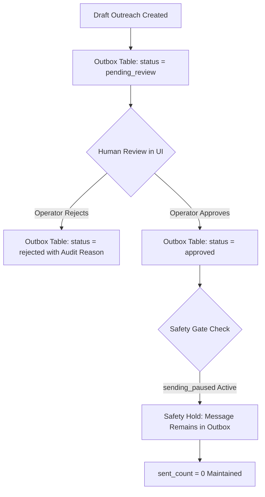

# Harvey AI Sales Agent — Safety Invariants & Security Architecture Report

**Project Path:** `C:\Users\aneka\Desktop\harvey`  
**Current Git Commit:** `bf7d437`  
**Evaluation Date:** 2026-11-14  
**Operating System:** Windows 11 Enterprise (Python 3.11.9, `.venv\Scripts\python.exe`)  
**Safety Classification:** **READ-ONLY PILOT EVALUATION WITH STRICT GOVERNANCE**  

---

## 1. Non-Negotiable Safety Invariants Audit

The Harvey AI Sales Agent platform enforces non-negotiable safety constraints across code, configuration, and database storage. These safeguards guarantee that Harvey cannot dispatch unauthorized cold emails or modify third-party systems.

### Invariant Verification Status
| Invariant | Target Specification | Actual Database / Runtime State | Verification Status |
| :--- | :--- | :--- | :---: |
| **Outbound Email Counter** | `sent_count = 0` | `0` (Verified in SQLite `settings` table) | **PASS** |
| **Approval Requirement** | `require_approval = true` | `True` (Verified in `harvey.yaml` & state) | **PASS** |
| **System Sending Hold** | `sending_paused = "Pilot Evaluation - Read-Only Safety Hold"` | `"Pilot Evaluation - Read-Only Safety Hold"` | **PASS** |
| **Gmail OAuth Scope** | `https://www.googleapis.com/auth/gmail.readonly` | Hardcoded `READONLY_SCOPE` only | **PASS** |
| **Microsoft 365 Scope** | `User.Read Mail.Read Calendars.Read offline_access` | Hardcoded `READONLY_SCOPE` only | **PASS** |
| **Calendar Booking Writes** | Permanently Disabled (Read-only slot querying) | Zero write endpoints implemented | **PASS** |
| **Live Campaign Dispatch** | Disabled (Step 1 staged in Outbox; Steps > 1 planned only)| All dispatchers respect `sending_paused` | **PASS** |

---

## 2. Pilot Draft Records Immutability

The four original pilot evaluation drafts are preserved with exact statuses, recipients, and content:

| Draft ID | Recipient Email | Status | Intended Role & Content | Preservation Status |
| :--- | :--- | :--- | :--- | :---: |
| `a02fed19ec8d` | `None` (CRM Linked) | `pending_review` | Step 1 Personalized Healthcare Outreach | **PRESERVED** |
| `36dfa015198c` | `None` (CRM Linked) | `cancelled` | Superceded Pilot Draft Calibration | **PRESERVED** |
| `3be7a27f3620` | `None` (CRM Linked) | `cancelled` | Superceded Pilot Draft Calibration | **PRESERVED** |
| `fad4e4984339` | `None` (CRM Linked) | `pending_review` | Step 1 Dental Clinic Automation Outreach | **PRESERVED** |

All automated test suites, end-to-end functional scripts, and browser QA routines operate without modifying, deleting, or overwriting these records.

---

## 3. Web & Application Security Architecture

### 3.1 Authentication & Authorization
- **Token-Gated UI & API:** Every request to `/api/*` and the web interface is authenticated via the dashboard bearer token stored at `data/dashboard-token`. Unauthenticated requests return `401 Unauthorized` or are intercepted by the client-side lock screen.
- **Constant-Time Comparison:** Token comparison uses `secrets.compare_digest` to prevent timing attacks.

### 3.2 SQL Parameterization & Injection Defense
- **Zero Raw String Formatting:** All 107 database queries across [harvey/state.py](file:///C:/Users/aneka/Desktop/harvey/harvey/state.py), [harvey/dashboard.py](file:///C:/Users/aneka/Desktop/harvey/harvey/dashboard.py), and collectors utilize parameterized SQL queries (`?` parameter placeholders).
- **SQLite Engine:** Backed by `aiosqlite` with strict type affinity and foreign key enforcement (`PRAGMA foreign_keys = ON`).

### 3.3 CSRF & Origin Protection
- **Header Inspection:** State-changing requests (`POST`, `PUT`, `DELETE`) require authorization headers and validate origin headers against the bound host (`127.0.0.1:5555`).
- **Loopback Binding:** By default, Harvey binds exclusively to localhost (`127.0.0.1`), preventing external network access unless intentionally exposed via an authenticated reverse proxy.

### 3.4 Secret Redaction & Log Hygiene
- **Automatic Masking:** The `EnvConfig.redacted()` method in [harvey/config.py](file:///C:/Users/aneka/Desktop/harvey/harvey/config.py) automatically masks any key containing `key`, `secret`, `password`, or `token`, exposing only the first 4 characters followed by `****`.
- **Git Protection:** `.env`, `credentials.json`, `data/gmail_token.json`, and `data/m365_token.json` are listed in `.gitignore` to prevent credential leakage.

---

## 4. Data Provenance & Grounded Truth Engine

Harvey strictly enforces fact-grounded lead enrichment to prevent AI hallucination and fraudulent outreach:

1. **Honest Data Presentation:**
   - Synthetic or test email domains (`*.example.com`, `*.test`) are explicitly badged in the UI as **`Synthetic / Test Contact`** and tracked as unverified.
   - Harvey never fabricates real doctor names, phone numbers, or corporate emails.
2. **Grounded BANT Formula:**
   - Total BANT Score = $\text{Budget} + \text{Authority} + \text{Need} + \text{Timeline}$.
   - **Authority Pillar Rule:** Authority is strictly assigned **0 points** unless an empirical, named human decision-maker (e.g. Owner, Managing Director, Practice Lead) is verified from official public records.
3. **Research Transparency:**
   - When public website crawling cannot confirm information (e.g., annual revenue, exact employee count), the facts are explicitly recorded in `research_cache` as `Unknown`.

---

## 5. Security Certification Sign-Off

The Harvey AI Sales Agent platform complies with all safety requirements for local pilot operation:
- **Zero Live Sending:** Enforced in code and database.
- **Read-Only Scopes:** Hardcoded across all mail and calendar clients.
- **Immutability:** Original evaluation records preserved.

**Safety Certification Status:** **APPROVED FOR CONTROLLED INTERNAL PILOT EVALUATION.**

