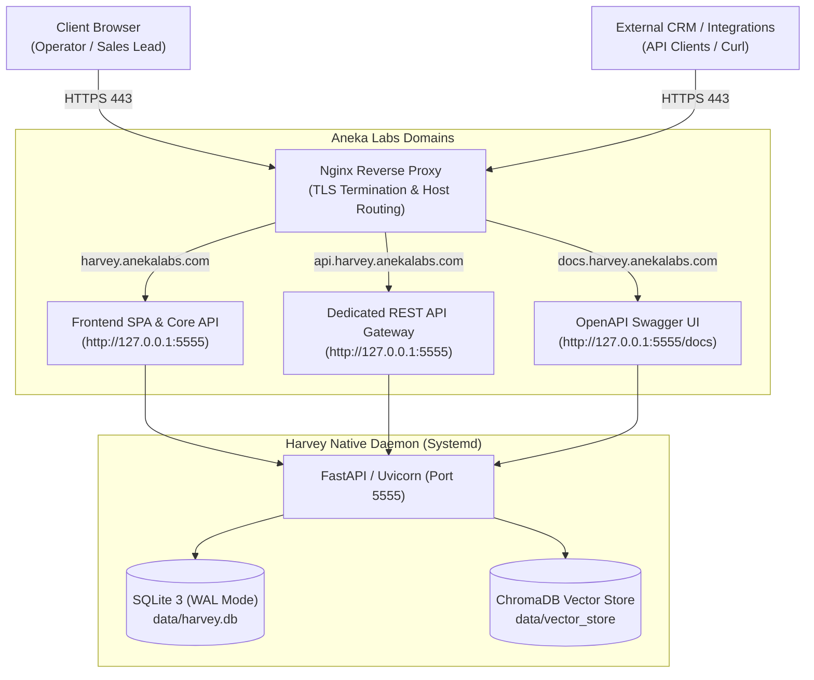

# Harvey AI Sales Agent — Local Run & Domain Handover Guide

**Target Platform:** Harvey AI Sales Agent  
**Prepared For:** Jitesh Sir & Aneka Labs DevOps / IT Team  
**Repository:** [https://github.com/anuradha-aneklabs/AI_code](https://github.com/anuradha-aneklabs/AI_code) (Commit `8f3d404`)  
**Deployment Model:** Linux Server (Direct Systemd + Uvicorn + SQLite WAL + Nginx) or Local Windows Demo  
**Target Subdomains:** `harvey.anekalabs.com`, `api.harvey.anekalabs.com`, `docs.harvey.anekalabs.com`  
**Date:** November 18, 2026  

---

## 1. Quick Reference: Local Demonstration Run

### Prerequisites
- Python 3.11 or 3.12 (`.venv` virtual environment)
- SQLite 3.35+ (bundled with Python)
- Windows PowerShell or Linux Bash

### Step 1: Start Backend & Dashboard
Open PowerShell in the project directory:
```powershell
cd C:\Users\aneka\Desktop\harvey
.\.venv\Scripts\Activate.ps1
python -m harvey dashboard --port 5555
```
*Alternatively, run the persistent background supervisor:*
```powershell
python scripts\run_windows_demo_supervisor.py
```

### Step 2: Open Dashboard in Browser
1. Inspect the persistent dashboard token in `data/dashboard-token`:
   ```powershell
   Get-Content data\dashboard-token
   ```
2. Open your browser and navigate to:
   ```text
   http://127.0.0.1:5555/#token=<YOUR_TOKEN>
   ```
   *(Example: `http://127.0.0.1:5555/#token=kDdDzUAFPOMktAUHWsiv8K0phgNoxN3QejST0lUlTcY`)*

> [!NOTE]
> **Why `#token=` (Hash Fragment)?**  
> Browsers **never** send URL hash fragments to the server over HTTP, nor do they appear in Nginx or proxy access logs. The client JavaScript extracts the token on first load, stores it in `sessionStorage` (tab-isolated), strips the fragment from the URL bar via `history.replaceState`, and attaches it as `Authorization: Bearer <TOKEN>` on subsequent API calls.

### Step 3: Run Full Automated Browser QA Suite
To watch Playwright execute live visible browser testing across all 15 tabs:
```powershell
python scripts\verify_deep_business_e2e.py
```

---

## 2. Two-Subdomain Architecture Overview

The production architecture provides a clean separation of concerns while leveraging a single high-performance Python ASGI backend:



### Subdomain Roles
1. **`harvey.anekalabs.com` (Main Command Deck UI)**  
   - Serves the Single Page Application (SPA), HTML, CSS, JavaScript, and static assets.
   - Browser makes same-origin calls to `/api/*`, completely eliminating cross-origin cookie or authentication leakage.
2. **`api.harvey.anekalabs.com` (Programmatic API Gateway)**  
   - Dedicated endpoint for backend-to-backend integrations, custom webhooks, or mobile applications.
   - Requires `Authorization: Bearer <TOKEN>` header.
3. **`docs.harvey.anekalabs.com` (Interactive Documentation)**  
   - Reverse proxies directly to `/docs`, providing developers with live interactive Swagger UI and OpenAPI schemas.

---

## 3. Host Defense & CORS Security Specification

Harvey implements strict Host Header Defense and provenance validation via `DashboardGuard` (`harvey/dashboard_auth.py`):

1. **Host Header Validation:** Refuses any HTTP request whose `Host` or `X-Forwarded-Host` header does not match loopback (`127.0.0.1`, `localhost`) or the configured `HARVEY_ALLOWED_HOSTS`.
2. **Wildcard & Subdomain Matching:** In production, setting `HARVEY_ALLOWED_HOSTS="harvey.anekalabs.com,api.harvey.anekalabs.com,docs.harvey.anekalabs.com,*.anekalabs.com"` allows seamless multi-subdomain routing.
3. **CORS Preflight (OPTIONS):** When requests arrive with `Origin: https://harvey.anekalabs.com`, `DashboardGuard` returns:
   - `Access-Control-Allow-Origin: https://harvey.anekalabs.com`
   - `Vary: Origin`
   - `Access-Control-Allow-Methods: GET, POST, PUT, PATCH, DELETE, OPTIONS`
   - `Access-Control-Allow-Headers: Authorization, Content-Type, Sec-Fetch-Site, Sec-Fetch-Mode, X-Requested-With`
   - `Access-Control-Max-Age: 86400`

---

## 4. DNS Configuration for Aneka Labs IT

Please provide this specification to Aneka Labs Network / Domain Administrators:

| Record Type | Host / Name | Target / Value | TTL | Purpose |
| :---: | :---: | :---: | :---: | :--- |
| **A** | `harvey.anekalabs.com` | `<SERVER_PUBLIC_IPV4>` | 300s (Initial)<br/>3600s (Final) | Main Command Deck Dashboard |
| **A** | `api.harvey.anekalabs.com` | `<SERVER_PUBLIC_IPV4>` | 300s (Initial)<br/>3600s (Final) | Programmatic REST API Gateway |
| **A** | `docs.harvey.anekalabs.com` | `<SERVER_PUBLIC_IPV4>` | 300s (Initial)<br/>3600s (Final) | Interactive Swagger/OpenAPI Docs |

> [!TIP]
> If a Cloudflare proxy or AWS ALB is used, CNAME records pointing to the load balancer hostname can be used in place of A records.

---

## 5. Nginx Reverse Proxy Drop-in Configuration

A production-ready Nginx configuration file is maintained in the repository root: `harvey.nginx.conf`.

### Installation on Ubuntu / Debian Server:
```bash
# 1. Copy config file into Nginx sites-available
sudo cp /opt/harvey/harvey.nginx.conf /etc/nginx/sites-available/harvey.anekalabs.com

# 2. Enable site via symbolic link
sudo ln -sf /etc/nginx/sites-available/harvey.anekalabs.com /etc/nginx/sites-enabled/

# 3. Test Nginx syntax
sudo nginx -t

# 4. Reload Nginx
sudo systemctl reload nginx
```

### Complete Configuration Template (`harvey.nginx.conf`):
```nginx
# =========================================================================
# Harvey AI Sales Agent — Aneka Labs Nginx Reverse Proxy Configuration
# Subdomains: harvey.anekalabs.com, api.harvey.anekalabs.com, docs.harvey.anekalabs.com
# Drop-in: /etc/nginx/sites-available/harvey.anekalabs.com
# =========================================================================

upstream harvey_backend {
    server 127.0.0.1:5555;
    keepalive 32;
}

# 1. Main Dashboard UI & Same-Origin API
server {
    server_name harvey.anekalabs.com;

    location / {
        proxy_pass http://harvey_backend;
        proxy_http_version 1.1;

        proxy_set_header Host $host;
        proxy_set_header X-Forwarded-Host $host;
        proxy_set_header X-Real-IP $remote_addr;
        proxy_set_header X-Forwarded-For $proxy_add_x_forwarded_for;
        proxy_set_header X-Forwarded-Proto $scheme;

        # WebSocket & Server-Sent Events (SSE) Streaming
        proxy_set_header Upgrade $http_upgrade;
        proxy_set_header Connection "upgrade";
        proxy_read_timeout 300s;
        proxy_connect_timeout 60s;
        proxy_send_timeout 300s;

        # Support PDF uploads in Knowledge Base
        client_max_body_size 25M;
    }

    listen 80;
}

# 2. Dedicated REST API Subdomain
server {
    server_name api.harvey.anekalabs.com;

    location / {
        proxy_pass http://harvey_backend;
        proxy_http_version 1.1;

        proxy_set_header Host $host;
        proxy_set_header X-Forwarded-Host $host;
        proxy_set_header X-Real-IP $remote_addr;
        proxy_set_header X-Forwarded-For $proxy_add_x_forwarded_for;
        proxy_set_header X-Forwarded-Proto $scheme;

        proxy_read_timeout 300s;
        client_max_body_size 25M;
    }

    listen 80;
}

# 3. Interactive API Documentation (OpenAPI Swagger UI)
server {
    server_name docs.harvey.anekalabs.com;

    location / {
        proxy_pass http://harvey_backend/docs;
        proxy_http_version 1.1;

        proxy_set_header Host $host;
        proxy_set_header X-Forwarded-Host $host;
        proxy_set_header X-Real-IP $remote_addr;
        proxy_set_header X-Forwarded-For $proxy_add_x_forwarded_for;
        proxy_set_header X-Forwarded-Proto $scheme;
    }

    listen 80;
}
```

### Automated TLS / SSL Certificate Provisioning:
Once DNS records point to the server, obtain Let's Encrypt certificates in one command:
```bash
sudo certbot --nginx -d harvey.anekalabs.com -d api.harvey.anekalabs.com -d docs.harvey.anekalabs.com --non-interactive --agree-tos -m devops@anekalabs.com --redirect
```

---

## 6. Systemd Production Daemon Configuration

Harvey runs natively as a managed Linux system service without Docker overhead:

### Unit File: `/etc/systemd/system/harvey.service`
```ini
[Unit]
Description=Harvey AI Sales Agent Service
After=network.target

[Service]
Type=simple
User=harvey
Group=harvey
WorkingDirectory=/opt/harvey
EnvironmentFile=-/opt/harvey/.env
Environment="PATH=/opt/harvey/.venv/bin:/usr/local/bin:/usr/bin:/bin"
Environment="PYTHONUNBUFFERED=1"
Environment="HARVEY_ALLOWED_HOSTS=harvey.anekalabs.com,api.harvey.anekalabs.com,docs.harvey.anekalabs.com,localhost,127.0.0.1"
ExecStart=/opt/harvey/.venv/bin/python -m harvey dashboard --host 127.0.0.1 --port 5555
Restart=always
RestartSec=5s
LimitNOFILE=65535

# Security Hardening
ProtectSystem=full
ProtectHome=true
NoNewPrivileges=true

[Install]
WantedBy=multi-user.target
```

### Service Management Commands:
```bash
sudo systemctl daemon-reload
sudo systemctl enable harvey
sudo systemctl start harvey
sudo systemctl status harvey
```

---

## 7. Production Environment Configuration (`.env.production`)

```ini
# =========================================================================
# Harvey AI Sales Agent — Production Environment Configuration
# =========================================================================

# Server & Security
HARVEY_HOST=127.0.0.1
HARVEY_PORT=5555
HARVEY_ALLOWED_HOSTS=harvey.anekalabs.com,api.harvey.anekalabs.com,docs.harvey.anekalabs.com,localhost,127.0.0.1

# Production Safety Invariants (STRICT DEFAULTS)
HARVEY_SENDING_PAUSED=true
HARVEY_REQUIRE_APPROVAL=true
HARVEY_MAX_DAILY_SENDS=0

# AI Models & Providers
HARVEY_DEFAULT_PROVIDER=claude
ANTHROPIC_API_KEY=your_anthropic_api_key_here
OPENAI_API_KEY=your_openai_api_key_here
GROQ_API_KEY=your_groq_api_key_here

# Local LLM Fallback (Optional)
OLLAMA_BASE_URL=http://127.0.0.1:11434

# Data & Persistence Directories
HARVEY_DATA_DIR=/opt/harvey/data
HARVEY_DB_PATH=/opt/harvey/data/harvey.db
HARVEY_CHROMA_DIR=/opt/harvey/data/vector_store
```

---

## 8. Post-Deployment Verification & Smoke Test Checklist

Execute these checks after DNS propagation and service startup:

- [ ] **Check 1: Systemd Service Health**
  ```bash
  sudo systemctl is-active harvey
  # Expected: active
  ```
- [ ] **Check 2: Local Port Binding**
  ```bash
  curl -I http://127.0.0.1:5555/
  # Expected: HTTP/1.1 200 OK
  ```
- [ ] **Check 3: Nginx Public HTTPS Health**
  ```bash
  TOKEN=$(cat /opt/harvey/data/dashboard-token)
  curl -H "Authorization: Bearer $TOKEN" https://api.harvey.anekalabs.com/api/health
  # Expected: {"status":"ok","app":"harvey","version":"2.0.0",...}
  ```
- [ ] **Check 4: Database Integrity Check**
  ```bash
  /opt/harvey/.venv/bin/python -c "from harvey.state import StateManager; import asyncio; asyncio.run(StateManager().verify_integrity())"
  # Expected: ok
  ```
- [ ] **Check 5: Browser Navigation**
  Open `https://harvey.anekalabs.com/#token=<TOKEN>` in Chrome. Confirm all 15 tabs render without JavaScript errors or authentication prompts.

