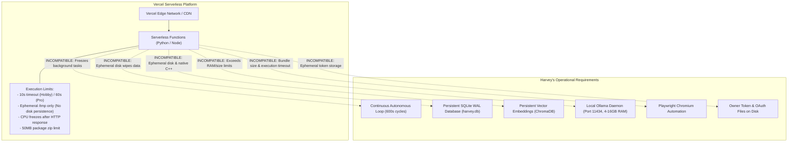
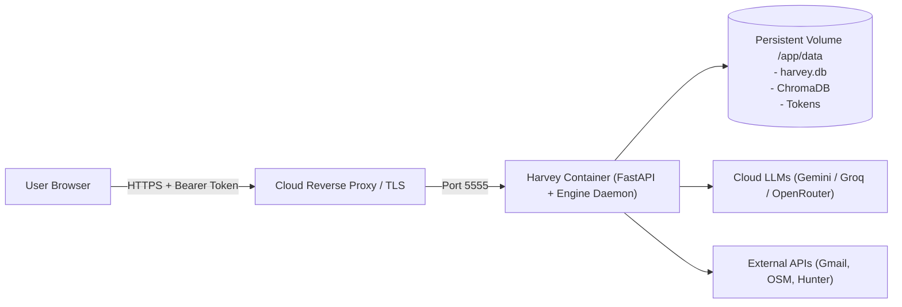

# Harvey – Vercel Deployment Readiness Audit

**Document Version:** 1.0.0
**Project:** Harvey AI Sales Agent (`C:\Users\aneka\Desktop\harvey`)
**Audit Scope:** Vercel Deployment Feasibility, Git Repository Preparation, Architecture Assessment, and Component Classification
**Date:** 2026-11-18

---

## Executive Summary & Verdict

This comprehensive audit evaluates the technical readiness of the Harvey AI Sales Agent project for GitHub repository sharing and Vercel cloud deployment.

### Final Deployment Verdict: **NOT SUPPORTED NATIVELY ON VERCEL ALONE**

Harvey is fundamentally architected as a **stateful, autonomous daemon system** featuring:
1. A continuous, long-running Python `asyncio` heartbeat loop (`harvey run`, `CYCLE_TIMEOUT_SECONDS = 600`).
2. An embedded local SQLite database (`data/harvey.db`) with WAL mode.
3. A local ChromaDB persistent vector database (`data/rag/chroma`).
4. A local open-weights Ollama inference and embedding daemon (`http://localhost:11434`).
5. Local browser automation using Playwright (Chromium binary ~300MB).
6. Local file-based owner token and OAuth credential storage.

**Vercel is an ephemeral, serverless platform** designed for stateless HTTP request/response lifecycles and Jamstack static frontends. Its serverless runtime enforces:
- Maximum execution timeouts of 10 seconds (Hobby) or 60 seconds (Pro).
- Ephemeral, read-only filesystems (only `/tmp` is writable, and it is wiped across cold starts).
- Immediate CPU termination as soon as an HTTP response finishes (no background daemons or `while True` loops).
- Strict package bundle limits (50 MB zipped, 250 MB unzipped), precluding local LLM weights, Ollama, and full browser binaries.

### Can Harvey operate without a local Windows machine?
**YES.** Harvey has native Linux and Docker support (`Dockerfile`, `docker-compose.prod.yml`, `harvey.service`). It can run 24/7 autonomously on a persistent cloud container or virtual machine (e.g., Railway, Render, Fly.io, or an AWS/DigitalOcean Linux VPS) with zero code modifications, preserving all features and data.

---

## 1. Component Classification Matrix

Every component has been inspected and classified according to the audit standard:
- **`READY`**: Can run in the target cloud environment without code modifications.
- **`NEEDS CHANGES`**: Requires configuration, adapter middleware, or external service binding.
- **`NOT SUPPORTED NATIVELY`**: Incompatible with Vercel serverless execution model; requires architectural decomposition or an alternative execution runtime.

| Component / Layer | Technology in Codebase | Vercel Classification | Technical Reason & Remediation Path |
|---|---|:---:|---|
| **Dashboard Frontend** | Vanilla JS / CSS / HTML5 SPA (`harvey/web/`) | **NEEDS CHANGES** | Static assets can be served via Vercel Edge CDN, but currently bundled inside the Python package and tightly coupled to FastAPI's `/` and `/static/*` endpoints with session token auth. Needs decoupling into a static deployment root. |
| **FastAPI Backend** | FastAPI + Starlette + Uvicorn (`harvey/dashboard.py`) | **NEEDS CHANGES** | Can run as a Vercel Serverless Function via `@vercel/python` or ASGI Mangum wrapper, but lifespan handlers (which auto-spawn background subprocesses) must be removed, and file-based token reads replaced by environment variables. |
| **Autonomous Engine Daemon** | Continuous `asyncio` Heartbeat Loop (`harvey/main.py`) | **NOT SUPPORTED NATIVELY** | Operates as an infinite `while True` loop with 600s cycle timeouts and 300s quiet-hour polling. Vercel serverless functions terminate at 10s–60s and freeze CPU between requests. Requires a dedicated background worker (e.g. Railway, Render, Celery, or AWS ECS). |
| **Ollama Local LLM** | Local Daemon (`harvey/providers/ollama.py`) | **NOT SUPPORTED NATIVELY** | Requires local CPU/GPU RAM and multi-GB open-weights model downloads (`qwen2.5:1.5b`, `llama3.2`). Vercel serverless functions cannot host or run Ollama models. Must be switched to cloud LLMs (Gemini Flash, Groq, OpenRouter) or a remote hosted Ollama instance. |
| **ChromaDB Vector Store (RAG)** | `chromadb.PersistentClient` (`harvey/rag/store.py`) | **NOT SUPPORTED NATIVELY** | Relies on local disk persistence at `data/rag/chroma` and compiled C++ HNSWlib binaries. Ephemeral filesystem in Vercel wipes embeddings on cold start. Requires migration to a managed vector DB (Pinecone, Qdrant Cloud, Supabase pgvector). |
| **RAG Embeddings Client** | Local Ollama Embeddings (`harvey/rag/embeddings.py`) | **NOT SUPPORTED NATIVELY** | Calls `http://localhost:11434` for `nomic-embed-text`. Incompatible with serverless. Must switch to a cloud embedding API (e.g., Google Gemini `text-embedding-004` or OpenAI `text-embedding-3-small`). |
| **SQLite State Manager** | `aiosqlite` WAL DB (`data/harvey.db`, `harvey/state.py`) | **NOT SUPPORTED NATIVELY** | Local file database. Ephemeral serverless containers cannot share or persist SQLite files across cold starts and concurrent lambdas. Requires migration to managed PostgreSQL (Neon, Supabase, RDS) or Turso (libSQL). |
| **Celery / Redis** | *Not Implemented in Harvey* | **NOT APPLICABLE** | Harvey uses internal `asyncio.gather` and SQLite state flags rather than Celery/Redis. Moving to a decoupled serverless model would require introducing an external queue (Upstash Redis, QStash, or Celery). |
| **Playwright / LinkedIn Automation** | Headless Chromium (`harvey/integrations/linkedin.py`) | **NOT SUPPORTED NATIVELY** | Exceeds Vercel bundle limits (~300MB browser); serverless timeouts prevent humanized delay scraping; local cookie file persistence fails. Requires offloading to a container worker or external scraping API. |
| **Cloud LLM Providers** | Gemini, Groq, OpenRouter, Claude, xAI (`harvey/providers/`) | **READY** | Stateless HTTPS API calls via `httpx`. Function perfectly inside serverless environments with environment variables. |
| **Discovery APIs** | OpenStreetMap Overpass, Nominatim, DataForSEO, Serper, Scavio | **READY** | Stateless HTTPS REST calls. Fully supported in serverless functions. |
| **Email Dispatch & Verification** | Gmail API, MS Graph, SMTP, TrulyInbox, ZeroBounce, Reoon | **NEEDS CHANGES** | API execution works, but OAuth authentication flows rely on local loopback HTTP listeners (`localhost:8765`, `localhost:8766`) and local token files (`data/gmail_token.json`). Must be converted to cloud OAuth redirect callbacks. |
| **Security & Host Validation** | `DashboardGuard` (`harvey/dashboard_auth.py`) | **NEEDS CHANGES** | `is_loopback(client_ip)` strictly rejects `X-Forwarded-Host` unless the direct client IP is `127.0.0.1` or `::1`. Vercel edge proxies deliver requests from public/internal subnet IPs, causing immediate HTTP 400 `bad_host` blocks unless proxy trust is configured. |
| **CLI Management Tools** | `harvey` CLI (`harvey.cli:main`) | **NOT SUPPORTED NATIVELY** | Terminal tool meant for local operator execution. Does not run inside Vercel web hosting. |

---

## 2. Vercel Execution Model vs. Harvey Architecture



### Detailed Breakdown of Incompatibilities:
1. **Lifecycle & Execution Limits:**
   - Harvey's `heartbeat()` loop in `harvey/main.py` uses `CYCLE_TIMEOUT_SECONDS = 600` (10 minutes) and sleeps for 300 seconds during quiet hours. Vercel aborts any function exceeding 10s (Hobby) or 60s (Pro).
   - Once a serverless HTTP request completes, Vercel immediately suspends CPU cycles. Harvey's background prospect discovery, enrichment, scoring, and drafting cannot execute in the background.
2. **Ephemeral vs. Persistent Storage:**
   - Harvey writes CRM state, campaigns, prospects, and logs directly to `data/harvey.db` via `aiosqlite`.
   - On Vercel, every cold start initializes a fresh container with an empty or read-only filesystem. Any write to `data/` is wiped when the container is recycled.
   - Multiple concurrent serverless invocations cannot safely mount or lock a shared SQLite file.
3. **Local AI Model Execution:**
   - Harvey's default configuration in `harvey.yaml` specifies `provider: "ollama"` and `model: "qwen2.5:1.5b"`.
   - Ollama requires a dedicated system daemon running on port 11434 with persistent storage for multi-gigabyte GGUF model weights. Vercel serverless containers cannot run background daemons or host large model weights.
4. **Browser Automation:**
   - `harvey/integrations/linkedin.py` uses Playwright to drive headless Chromium with persistent session cookies (`data/linkedin_cookies.json`).
   - The Chromium browser binary (~300MB) exceeds Vercel's 50MB zipped deployment package limit.

---

## 3. Full Inventory: Environment Variables, Credentials, Paths & URLs

### A. Environment Variables & Secret Credentials
All variables discovered across `.env.example`, `harvey/config.py`, and integrations:

| Category | Environment Variable | Purpose / Service | Required for Core Operation? |
|---|---|---|:---:|
| **AI Providers** | `OLLAMA_BASE_URL` | Base URL for local Ollama daemon (default `http://localhost:11434`) | Optional (if using Cloud LLMs) |
| | `GEMINI_API_KEY` | Google Gemini API (Free tier: 15 RPM / 1M TPM) | Recommended Free Cloud LLM |
| | `GROQ_API_KEY` | Groq LPU inference (Free tier: Llama 3.3 70B) | Recommended Free Cloud LLM |
| | `OPENROUTER_API_KEY` | OpenRouter community & free models | Recommended Free Cloud LLM |
| | `XAI_API_KEY` | xAI Grok API (Paid only) | Optional |
| **Email Channels** | `GMAIL_CLIENT_ID` | Google Cloud OAuth2 Client ID | Required for Gmail |
| | `GMAIL_CLIENT_SECRET` | Google Cloud OAuth2 Client Secret | Required for Gmail |
| | `SMTP_HOST`, `SMTP_PORT` | Custom SMTP host and port (default 587) | Required for SMTP |
| | `SMTP_USERNAME`, `SMTP_PASSWORD`| Custom SMTP mailbox credentials | Required for SMTP |
| | `IMAP_HOST`, `IMAP_PORT` | Custom IMAP host and port (default 993) | Required for SMTP Reply Reading |
| | `IMAP_USERNAME`, `IMAP_PASSWORD`| Custom IMAP credentials | Required for SMTP Reply Reading |
| | `M365_CLIENT_ID`, `M365_TENANT_ID`| Microsoft Entra ID App Credentials | Required for Microsoft 365 |
| | `INSTANTLY_API_KEY` | Instantly.ai cold email API key | Optional (Legacy) |
| **Safety Guardrails**| `TEST_RECIPIENT_EMAIL` | Whitelist recipient for controlled test sends | Strongly Recommended |
| | `REQUIRE_APPROVAL` | Enforces human approval before sending (`true`) | Mandatory Safety Hold |
| | `LIVE_SENDING_ENABLED` | Global master switch for outbound email (`false`) | Mandatory Safety Hold |
| **Email Verification**| `REOON_API_KEY` | Reoon email verifier API (600 free/mo) | Strongly Recommended |
| | `ZEROBOUNCE_API_KEY` | ZeroBounce API (100 free/mo) | Strongly Recommended |
| | `HUNTER_API_KEY` | Hunter.io verification & domain pattern search | Optional |
| | `HUNTER_MONTHLY_SEARCHES`| Monthly search limit (default 25) | Optional |
| | `PRECLEARED_API_KEY` | Precleared compliance check API | Optional |
| | `TRULYINBOX_API_KEY` | TrulyInbox mailbox warmup tracking | Optional |
| | `TRULYINBOX_WORKSPACE_ID`| TrulyInbox workspace identifier | Optional |
| **Lead Discovery** | `DATAFORSEO_LOGIN`, `_PASSWORD` | DataForSEO SERP & business data API | Optional |
| | `DATAFORSEO_SANDBOX` | Toggle for free sandbox mode | Optional |
| | `SERPER_API_KEY` | Serper.dev Google Search API | Optional |
| | `SCAVIO_API_KEY` | Scavio Google Maps & search listings API | Optional |
| | `TINYFISH_API_KEY` | TinyFish web search API | Optional |
| | `NOMINATIM_CONTACT_EMAIL`| Operator email for OpenStreetMap Nominatim | Mandatory for OSM |
| **Browser Automation**| `LINKEDIN_EMAIL`, `_PASSWORD` | LinkedIn credentials for Playwright | Optional |
| | `CLOUDFLARE_ACCOUNT_ID`, `_TOKEN`| Cloudflare Browser Rendering API | Optional |
| **Production Network**| `HARVEY_ALLOW_REMOTE_BIND` | Allows binding to `0.0.0.0` (`1` in cloud containers) | Required for Containers |
| | `HARVEY_ALLOWED_HOSTS` | Comma-separated allowlist of valid hostnames | Required for Production |
| | `HARVEY_PORT`, `HARVEY_BIND_IP`| Listening port (5555) and bind address | Optional |
| | `HARVEY_DASHBOARD_TOKEN` | Static owner dashboard token | Recommended for Cloud |

### B. Local File Paths & Storage Touchpoints
Harvey relies on the following local filesystem locations defined relative to `PROJECT_ROOT`:
- `data/harvey.db`: SQLite database file (CRM tables, prospects, companies, campaigns, conversations).
- `data/dashboard-token`: Owner authentication token (read/written on disk with POSIX `0o600` permissions).
- `data/gmail_token.json`: Google OAuth refresh token file.
- `data/rag/chroma`: ChromaDB vector database index and document chunk store.
- `data/linkedin_cookies.json`: Playwright session cookies.
- `data/linkedin_activity.json`: Rate-limit activity counter for LinkedIn actions.
- `data/harvey.pid` & `data/harvey.lock`: Engine process lockfiles.
- `prompts/` & `skills/`: Markdown templates for AI prompt generation and persona instructions.
- `harvey.yaml`: Main application configuration.

### C. Hardcoded Localhost URLs in Source Code
The following local hostnames and loopback URLs exist in the codebase:
1. `http://localhost:11434` — Default Ollama API endpoint in `harvey/providers/ollama.py` and `harvey/rag/embeddings.py`.
2. `http://localhost:8765` — Gmail OAuth loopback callback listener in `harvey/integrations/gmail.py` and `harvey/dashboard.py`.
3. `http://localhost:8766` — Microsoft OAuth loopback callback listener in `harvey/integrations/microsoft.py`.
4. `http://127.0.0.1:5555` — Default dashboard bind and Microsoft authorize redirect URI.

*In a cloud serverless environment, local loopback redirect URIs (`http://localhost:8765`) fail because the cloud container cannot spin up a temporary local port to catch OAuth redirects from the user's browser.*

---

## 4. Production Security, CORS, Authentication & Proxy Headers

### Host Header & Reverse Proxy Validation
In `harvey/dashboard_auth.py`, the `DashboardGuard` middleware validates incoming HTTP requests:
```python
fwd_hosts = headers.get("x-forwarded-host", [])
if fwd_hosts:
    client_ip = (scope.get("client") or [None])[0]
    if not client_ip or not is_loopback(client_ip):
        return await deny(400, "bad_host", "Untrusted proxy connection for X-Forwarded-Host.")
```
- **Vercel Issue:** In Vercel, requests are terminated by Vercel's global edge network (Cloudflare/AWS) and forwarded to serverless lambdas. The `client_ip` received by the lambda is an internal cloud proxy IP (e.g. `10.x.x.x`), **not a loopback IP**.
- **Result:** Every request to a Vercel-deployed Harvey backend will be rejected with HTTP 400 `bad_host` ("Untrusted proxy connection for X-Forwarded-Host") unless the middleware is adapted to recognize cloud proxy environments.

### Dashboard Authentication
- Harvey generates a high-entropy hex token stored in `data/dashboard-token`.
- On Vercel, each serverless invocation running in a new lambda container would attempt to read `data/dashboard-token`. Since `/app/data` is ephemeral, each lambda would generate a different random token, invalidating user sessions.
- **Remediation:** Support `HARVEY_DASHBOARD_TOKEN` as an environment variable in production so authentication persists across all serverless lambda instances.

---

## 5. Git Repository Preparation & Security Exclusions

Before sharing the codebase on GitHub or pushing to a remote repository, sensitive files, private data, local databases, and large demo media must be strictly excluded.

### A. Files That MUST Be Excluded from Git
1. **Credentials & Secrets:**
   - `.env`, `*.env` (Contains API keys, OAuth secrets, SMTP passwords).
   - `data/dashboard-token` (Master dashboard owner token).
   - `data/gmail_token.json` (Active Google OAuth access/refresh tokens).
   - `data/linkedin_cookies.json` (Authenticated browser cookies).
   - `data/.nominatim_lock`, `data/.nominatim_throttle` (Local lock files).
2. **Databases & Local State:**
   - `data/harvey.db` (Real CRM database: 81 companies, 148 prospects, 53 campaigns).
   - `data/*.db`, `data/*.db.bak*` (All database backups).
   - `data/rag/` (ChromaDB vector store, sqlite files, embeddings).
   - `data/*.pid`, `data/*.lock` (Process locks and PID files).
   - `data/*.log` (`dashboard.log`, `harvey.log`, `demo_supervisor.log`).
3. **Heavy Media & Temporary Demo Artifacts:**
   - `client_demo_output/` (~200MB+ of high-definition video recordings, audio voiceovers, and raw screenshots).
   - `reports/` (Local test logs and debug runs).
   - `requirements.txt.bak` (Temporary backup).
   - `.venv/`, `venv/`, `__pycache__/`, `.pytest_cache/`.

### B. Security Audit of Git History
A check of the current commit log (`af01aea`, `4bb5858`, `db32379`) confirms that no credentials, tokens, or SQLite databases have been committed to git history. Only `.env.example` and public test definitions are tracked.

### C. Recommended Updated `.gitignore`
To guarantee zero secret leaks and keep repository size minimal:
```gitignore
# Environment & Secrets
.env
*.env
*.pem
*.key
credentials.json
client_secrets.json

# Local Data, Databases & Vector Store
data/
*.db
*.sqlite3
*.db-journal
*.db-wal

# Owner Tokens & OAuth
*token*
!*token*.py
!test*token*.py
linkedin_cookies.json
linkedin_activity.json

# Logs & Runtime Locks
*.log
*.pid
*.lock

# Large Media & Demo Output
client_demo_output/
*.mp4
*.wav
*.mkv

# Python Artifacts & Environments
__pycache__/
*.py[cod]
*$py.class
*.egg-info/
dist/
build/
.venv/
venv/
.pytest_cache/

# User & Generated Configs
skills/product_knowledge.md
skills/email_rules.md
skills/competitive_intel.md
harvey.local.yaml
harvey.local.yaml.*
harvey.yaml.*
```

---

## 6. Recommended Deployment Architectures

To run Harvey reliably without relying on a local Windows machine, three architectural paths exist:

### Architecture Option A: Containerized Cloud Deployment (RECOMMENDED)
*Zero code changes required. 100% feature preservation.*

Deploy Harvey as a persistent container on a modern cloud platform:
- **Target Platforms:** Railway, Render (Web Service + Persistent Disk), Fly.io, or an AWS Lightsail / DigitalOcean Linux VPS ($5–$12/month).
- **Execution Model:** Docker container running `harvey dashboard` and the engine daemon using the existing `Dockerfile` and `docker-compose.prod.yml`.
- **Persistence:** Mount a persistent cloud volume to `/app/data` to retain SQLite (`harvey.db`), ChromaDB (`data/rag/`), and tokens.
- **AI Tier:**
  - Option 1 (Free Cloud LLMs): Set `brain.provider: "gemini"` or `"groq"` in `harvey.yaml` (utilizing Google Gemini 1.5 Flash or Groq Llama 3.3 70B free tiers with zero infrastructure cost).
  - Option 2 (Self-Hosted Ollama): Run Ollama in a companion container on a GPU/high-RAM VPS, or connect to a hosted remote Ollama server.
- **Advantages:**
  - 100% compatibility with all 15 dashboard tabs.
  - Autonomous heartbeat daemon runs continuously.
  - Background enrichment, research, and reply detection function without interruption.
  - Preserves all existing SQLite schema and ChromaDB embeddings.



---

### Architecture Option B: Decoupled Hybrid (Vercel Frontend + Managed Cloud Backend)
*Modern Jamstack architecture.*

- **Frontend on Vercel:** Extract the dashboard UI from `harvey/web/` into a dedicated static project on Vercel Edge Network.
- **Backend on Railway / Render:** Host the FastAPI backend, background workers, and SQLite/ChromaDB on a persistent container service.
- **Communication:** Vercel frontend connects to the backend API via HTTPS (`NEXT_PUBLIC_API_URL` or standard REST endpoints with CORS headers).
- **Advantages:**
  - Vercel's fast global CDN for static dashboard loading.
  - Persistent cloud backend handles the long-running engine and databases.

---

### Architecture Option C: Pure Serverless Re-Architecture (HIGH EFFORT)
*Requires extensive codebase rewrites.*

To run entirely on Vercel serverless functions:
1. **Database:** Migrate SQLite to managed serverless PostgreSQL (e.g. Neon, Supabase) via SQLAlchemy or Prisma.
2. **Vector Store:** Replace local ChromaDB with Pinecone, Qdrant Cloud, or Supabase pgvector.
3. **Heartbeat & Daemons:** Deconstruct `harvey/main.py` into discrete Vercel Serverless Functions triggered via **Vercel Cron** (e.g., `/api/cron/discover`, `/api/cron/qualify`, `/api/cron/draft`).
4. **Task Orchestration:** Introduce an asynchronous serverless job orchestrator (such as Upstash QStash or Inngest) to handle multi-step workflows without exceeding 10s/60s function timeouts.
5. **AI Tier:** Completely eliminate Ollama; standardize on Gemini Flash / Groq / OpenAI APIs for generation and embeddings.
6. **Browser Scraping:** Replace Playwright with an external web scraping API (ScrapingBee, Bright Data).
7. **Effort Estimate:** 3–4 weeks of engineering; high architectural risk; alters core project design.

---

## 7. Step-by-Step Action Plan for GitHub & Cloud Deployment

### Phase 1: Repository Preparation & Sanitization (Pre-Push)
1. Verify `.gitignore` excludes `.env`, `data/`, `client_demo_output/`, `reports/`, and all `*.log` / `*.pid` files.
2. Ensure `.env.example` is fully updated with all configuration options.
3. Keep `START_HARVEY_DEMO.bat` and `STOP_HARVEY_DEMO.bat` tracked as convenient tools for Windows operators.
4. Run `git status` to ensure only clean source code, tests, documentation, and configuration files are staged.

### Phase 2: Cloud Platform Deployment (Recommended: Railway / Render)
1. Push repository to private GitHub repository: `git push origin main`.
2. Connect GitHub repository to **Railway** or **Render**.
3. Configure build settings:
   - Build Type: `Dockerfile`
   - Healthcheck Path: `http://127.0.0.1:5555/`
4. Attach a **Persistent Volume**:
   - Mount Path: `/app/data`
   - Size: 5 GB – 10 GB
5. Configure Environment Variables in Cloud Dashboard:
   - `HARVEY_ALLOW_REMOTE_BIND=1`
   - `HARVEY_ALLOWED_HOSTS=*` (or your assigned cloud domain)
   - `HARVEY_PORT=5555`
   - `BRAIN_PROVIDER=gemini` (or `groq`)
   - `GEMINI_API_KEY=...` (or `GROQ_API_KEY=...`)
   - `NOMINATIM_CONTACT_EMAIL=your-email@domain.com`
   - `REQUIRE_APPROVAL=true`
   - `LIVE_SENDING_ENABLED=false`
6. Deploy and verify dashboard access, token unlock, and automated health checks.
