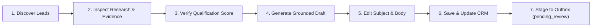

# Harvey AI Sales Agent — Internal Pilot Runbook & Safe Operator Guide

**Document Version:** 1.0  
**Target Release:** MVP Internal Pilot  
**Target Platform:** Windows 11 (PowerShell) / Python 3.11+  
**Project Path:** `C:\Users\aneka\Desktop\harvey`  
**Security Status:** Read-Only Evaluation Hold Active (`sent_count = 0`, live email sending disabled)

---

## 1. Project Overview

### What Harvey Does
Harvey is an autonomous B2B sales development assistant designed for small teams and solo founders. It discovers high-fit prospective companies matching an Ideal Customer Profile (ICP), extracts factual research from official web sources, calculates deterministic qualification fit scores, prepares evidence-grounded outreach email drafts, and stages drafts into an Outbox requiring explicit human approval before delivery.

### Current MVP Features
1. **Configurable Lead Discovery & ICP Scoring:** Industry, company size, and global geography targeting (Worldwide, All India, or Local) with 0-100 deterministic scoring and data confidence calculation.
2. **Company Research & Enrichment:** Automated extraction of company overviews, products/services, and target customers with clickable public source URLs.
3. **Evidence-Grounded Outreach Drafts:** AI-assisted introductory draft generation grounded in verified company research and use cases.
4. **In-Place Subject & Body Editor:** Full inline editing with instant preview before staging.
5. **Two-Way CRM Pipeline Coordination:** Automatic pipeline progression through stages: `New` &rarr; `Researched` &rarr; `Qualified` &rarr; `Outreach Draft Ready` &rarr; `Contacted` &rarr; `Interested` &rarr; `Meeting Booked`.
6. **Human-in-the-Loop Outbox Review:** All emails are staged as `pending_review`.
7. **Multi-Provider AI Engine:** Free-first local and cloud models (Ollama, Gemini, Groq, OpenRouter) with strict approval guards against paid providers.
8. **Operational Database Tools:** Native online SQLite point-in-time snapshots and integrity diagnostics (`harvey db backup`, `harvey db verify`).

### Current Pilot Limitations
- **Live Email Sending Disabled:** Sending is locked in read-only hold (`sending_paused = "Pilot Evaluation - Read-Only Safety Hold"`).
- **Gmail Read-Only Scope:** Gmail integration strictly requests `https://www.googleapis.com/auth/gmail.readonly`.
- **Single-Tenant Loopback Interface:** Dashboard binds strictly to `127.0.0.1:5555` with local Bearer token authentication.

---

## 2. Environment Setup

### Prerequisites
- **Operating System:** Windows 10/11 (x64)
- **Python:** Python 3.11.9+
- **Shell:** Windows PowerShell 5.1 or PowerShell 7+
- **Local AI Engine (Optional for offline demo):** Ollama installed at `http://localhost:11434` with model `qwen2.5:1.5b`

### PowerShell Setup Instructions
Open Windows PowerShell and navigate to the project directory:

```powershell
# 1. Navigate to the Harvey project root
cd C:\Users\aneka\Desktop\harvey

# 2. Activate Python Virtual Environment
.\.venv\Scripts\Activate.ps1

# 3. Verify Python and Harvey CLI
python --version
.\.venv\Scripts\harvey.exe --help
```

### Safe Handling of `.env` and Credentials
- The `.env` file holds sensitive API keys and mailbox secrets and is strictly git-ignored (`.gitignore` protects `.env`).
- Never commit `.env` or paste its contents into chat logs or presentation materials.
- Configuration templates are provided in `.env.example`.
- To inspect configuration safely without exposing secrets:
  ```powershell
  python -c "from harvey.config import load_env; print(load_env().redacted())"
  ```

---

## 3. Startup and Shutdown

### Starting the Services

Harvey uses two local components:
1. **Ollama Serve Daemon** (Local AI inference — runs in background)
2. **Harvey Dashboard** (FastAPI backend and UI — port 5555)

#### Step 1: Start Ollama (Background AI Daemon)
```powershell
& "$env:LOCALAPPDATA\Programs\Ollama\ollama.exe" serve
```
*Note: If Ollama is already running as a Windows service, this step can be skipped.*

#### Step 2: Start the Harvey Dashboard
In your active virtual environment terminal:
```powershell
.\.venv\Scripts\harvey.exe dashboard
```

Expected output:
```text
  Harvey Dashboard running. Open this link to unlock it:

    http://127.0.0.1:5555/#token=<secure_token>

  The token is stored in C:\Users\aneka\Desktop\harvey\data\dashboard-token (owner-only).
  Press Ctrl+C to stop.
```

#### Step 3: Access the Web UI
Open the printed link in Chrome or Edge:
```text
http://127.0.0.1:5555/#token=<token>
```
*The token fragment is stored locally in `sessionStorage` and immediately stripped from the address bar for browser privacy.*

### Stopping the Services
- **Dashboard:** Press `Ctrl + C` in the terminal running `harvey dashboard`.
- **Ollama:** Close the Ollama terminal or exit the process from the Windows notification area.

---

## 4. End-to-End Demo Workflow

This 7-step walkthrough demonstrates the full operator flow in under 5 minutes:



### Step 1: Discover Leads
1. In the dashboard, click the **Discover** tab in the top navigation bar.
2. Select an active Ideal Customer Profile (e.g., *Logistics & Supply Chain* or *Healthcare*).
3. Select geography scope (*Worldwide* or *All India*).
4. Click **Find Leads**.
5. Discovered candidate cards appear with fit tier badges (e.g. `Tier 1: High Fit`), fit reasons, and verified decision-makers.

### Step 2: Inspect Company Research & Evidence
1. Click **View Research** on a discovered company card.
2. The Company Research panel opens showing:
   - **Company Overview:** Extracted core focus.
   - **Target Customers & Use Cases:** Identified market fit.
   - **Verified Facts:** Factual points marked with clickable public citation links.
   - **Sources:** Clickable external URLs confirming provenance.

### Step 3: Verify Lead Qualification Fit
1. Inspect the qualification score gauge (`0 - 100`) and confidence percentage (`0% - 100%`).
2. Notice deterministic breakdown:
   - Industry Fit Points (+30)
   - Company Size Eligibility (+20)
   - Verified Contact / Title Fit (+20)
   - Public Evidence Completeness (+20)
   - Geographic Eligibility (+10)
3. Confirm that leads below 60 points are marked `Unqualified` and cannot be drafted.

### Step 4: Generate Personalized Outreach Draft
1. Click **Generate Outreach Draft** on the qualified lead card.
2. The outreach modal opens with draft parameters:
   - Recipient Name and Verified Email
   - Value Proposition grounded in research
   - Grounded personalized subject and message body
   - Evidence Citation tags linking back to public registry or website sources.

### Step 5: Edit Subject and Body In-Place
1. Directly modify the **Subject** line in the modal (e.g., customize to highlight an operational pain point).
2. Edit the **Email Body** (e.g., adjust greeting or call-to-action).
3. The live word count and pre-send compliance checks update dynamically.

### Step 6: Save Draft and Update CRM Pipeline
1. Click **Save Outreach Draft**.
2. A success toast confirms: `"Outreach draft saved! CRM pipeline updated to 'Outreach Draft Ready'."`
3. Click the **CRM Pipeline** tab in the top navigation.
4. Verify the candidate has automatically advanced to the **Outreach Draft Ready** column (it is **never** moved to `Contacted` before an actual send).

### Step 7: Manual Review Staging in Outbox
1. Re-open the draft modal or click **Mark Ready for Review**.
2. Click the **Outbox** tab in the top navigation bar.
3. Observe the newly created sequence item sitting under **Waiting on you** with status `pending_review`.
4. Note the prominent safety banner:  
   `"Sending is paused (Pilot Evaluation - Read-Only Safety Hold). Approve drafts safely without delivery."`

---

## 5. Safe Demo Data Guidelines

> [!IMPORTANT]
> To ensure zero privacy risks and zero accidental contact with external parties during internal presentations, strictly adhere to these safe demo data rules:

1. **Use Fictional Domains Only:**
   - Use `.example.com`, `.example.org`, or `.local` domains (e.g. `apexcloudlogistics.example.com`, `starlightcleantech.com`).
   - Do not enter real prospect domains or active client business domains during demonstrations.
2. **Use Fictional Contacts:**
   - Use dummy names (e.g. `Jordan Vance`, `Alex Mercer`, `Dr. Jane Doe`).
   - Use dummy emails ending in `@example.com` or `@workspace.local`.
3. **Verify Demo Flags:**
   - Demo leads are tagged with `is_sample = 1` in the database.
4. **Preserve Original Pilot Records:**
   - Do not edit, delete, or re-stage the 4 existing dental pilot drafts (`a02fed19ec8d`, `36dfa015198c`, `3be7a27f3620`, `fad4e4984339`).

---

## 6. Database Operations & Disaster Recovery

Harvey stores all operational state, discovery records, research, CRM contacts, and outbox queues in SQLite (`data/harvey.db`) running in Write-Ahead Logging (WAL) mode.

### Verify Database Integrity
To verify database health, schema migrations, and passive checkpoints:

```powershell
.\.venv\Scripts\harvey.exe db verify
```

Expected output:
```text
  ✓ SQLite Integrity Check: PASSED
    Schema Version (PRAGMA user_version): 20
    Quick Check Output: ok
    Database Path: C:\Users\aneka\Desktop\harvey\data\harvey.db
```

### Create a Point-in-Time Database Backup
Harvey provides an online backup utility that captures a consistent snapshot without locking tables or interrupting active users:

```powershell
# Create an automated timestamped backup in data/backups/
.\.venv\Scripts\harvey.exe db backup

# Or specify a custom backup destination path
.\.venv\Scripts\harvey.exe db backup --dest data\backups\pre_demo_snapshot.db
```

### Safe Restore Procedure (Using a Test Database)
> [!CAUTION]
> **Never overwrite `data/harvey.db` directly while testing restore procedures!**
> Always validate backup restoration against an isolated target database.

#### Step-by-Step Verified Safe Restore:
Run this PowerShell test snippet to verify that a backup restores cleanly into an isolated test database:

```powershell
python -c "
import sqlite3, asyncio
from harvey.state import StateManager

# 1. Point to the backup to restore
backup_file = 'data/backups/harvey_backup_20261105_052720.db'
test_restore_db = 'data/test_restore_verification.db'

# 2. Restore into isolated test DB using SQLite native backup API
src = sqlite3.connect(backup_file)
dst = sqlite3.connect(test_restore_db)
src.backup(dst)
dst.close()
src.close()

# 3. Verify restored test DB
sm = StateManager(test_restore_db)
res = asyncio.run(sm.verify_integrity())
print('Restored Test DB Integrity:', res['quick_check'], '| Version:', res['user_version'])
assert res['ok'] is True
print('✓ Restore verification successful!')
"
```

---

## 7. Troubleshooting Common Issues

### Issue 1: Dashboard Fails to Start (Address in Use)
- **Symptom:** `OSError: [WinError 10048] Only one usage of each socket address is normally permitted`
- **Cause:** Another instance of `harvey dashboard` is already running on port 5555.
- **Fix:**
  ```powershell
  # Find process listening on port 5555
  netstat -ano | findstr :5555
  # Terminate by PID
  taskkill /PID <PID> /F
  # Restart dashboard
  .\.venv\Scripts\harvey.exe dashboard
  ```

### Issue 2: Token Missing or Locked
- **Symptom:** Dashboard displays `401 Unauthorized` or requests an unlock token.
- **Cause:** Browser opened `http://127.0.0.1:5555` without `#token=...`.
- **Fix:** Run the following command to retrieve the current unlock URL:
  ```powershell
  .\.venv\Scripts\harvey.exe dashboard --url
  ```
  Copy and open the full link in your browser.

### Issue 3: Ollama Connection Error
- **Symptom:** Outreach generation returns `Provider ollama error: connection refused`.
- **Cause:** Ollama background daemon is not running.
- **Fix:**
  ```powershell
  # Start Ollama
  & "$env:LOCALAPPDATA\Programs\Ollama\ollama.exe" serve
  # Verify in another terminal
  curl http://localhost:11434/api/tags
  ```

### Issue 4: Lead Discovery Search Returns No Results
- **Symptom:** Discovery returns 0 candidates.
- **Cause:** External search rate limit reached or offline environment.
- **Fix:** Check **Use Sample Cache / Fallback Provider** in the Discovery tab options. Harvey will instantly load verified offline candidate profiles.

---

## 8. Operator Demo Checklists

### Pre-Demo Checklist (10 Minutes Prior)
- [ ] Active directory is `C:\Users\aneka\Desktop\harvey`.
- [ ] Virtual environment activated (`.\.venv\Scripts\Activate.ps1`).
- [ ] Database verified: `.\.venv\Scripts\harvey.exe db verify` returns `PASSED`.
- [ ] Create pre-demo backup: `.\.venv\Scripts\harvey.exe db backup`.
- [ ] Ollama service running on `http://localhost:11434`.
- [ ] Dashboard running on `http://127.0.0.1:5555`.
- [ ] Browser window open with clean zoom (100%) on the dashboard.
- [ ] Verify safety status: `sent_count = 0` and sending paused hold visible in UI banner.

### During-Demo Checklist
- [ ] Show **Discover** tab and highlight deterministic ICP scoring breakdown.
- [ ] Open **Company Research** and point out clickable public evidence sources.
- [ ] Generate an **Outreach Draft** to show grounded personalization.
- [ ] Edit the subject and body in-place to demonstrate human-in-the-loop flexibility.
- [ ] Save the draft and show automatic CRM pipeline transition to `Outreach Draft Ready`.
- [ ] Open the **Outbox** to demonstrate safety: drafts wait as `pending_review` and are never sent autonomously.

### Post-Demo Checklist
- [ ] Run `python scratch/validate_demo_workflow.py` to confirm zero unintended changes.
- [ ] Confirm `sent_count` is still 0.
- [ ] Confirm original pilot drafts remain intact.
- [ ] Stop background test servers if no longer needed (`Ctrl + C`).

---

## 9. Known Limitations and Next Steps

| Current Pilot State | Next Production Phase |
| :--- | :--- |
| Read-only pilot safety hold active (`sent_count = 0`). | Connect dedicated warm domain with SPF/DKIM/DMARC alignment. |
| Single-tenant loopback dashboard authentication. | Implement reverse-proxy SSO/OIDC for multi-user internal network access. |
| On-demand manual SQLite snapshot backups. | Configure automated daily snapshot backups with cloud rotation. |
| Local Ollama / Free-tier Cloud AI models. | Introduce automated model fallback telemetry and production token quotas. |

